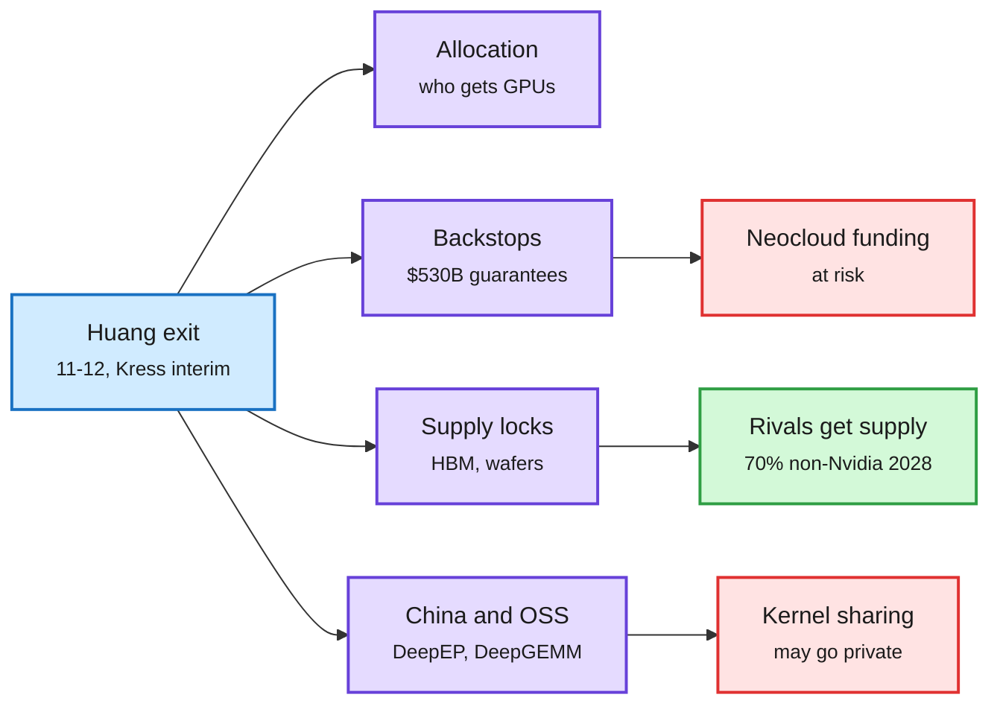

# Nvidia and the world without Jensen

## TL;DR

Jensen Huang resigned as Nvidia's CEO, president and board member on 11-12, effective immediately, after reports of a relationship with Alice Huang (an alleged Chinese intelligence asset tied to Singapore's Megaspeed) and with at least two Nvidia employees. CFO Colette Kress is interim CEO and keeps the CFO role; Harvey C. Jones became board chair. The stock fell as much as 13 to 14% intraday and closed down 4.34% at $166.19; Bernstein cut its target from $400 to $200. The Decoder puts the scandal's cumulative market-value loss at $1.4 trillion. SemiAnalysis argues the resignation is tied to GPU smuggling (its Accelerator Model tracks over 1.5 GW of restricted Nvidia chips ending up in China) and that Nvidia's advantages were personal to Huang: chip allocation, the backstop book, CEO-to-CEO supply deals, and engagement with Chinese open-source labs.

Four things Jensen held personally

Each one loosens without him; SemiAnalysis expects over 70% of 2028 capacity to be non-Nvidia.

Blue is the event, purple is what Huang personally controlled, red is downside risk, green is the opening for rivals.

## Key claims (SemiAnalysis, with numbers)

- **Structure:** about 60 direct reports and no deep bench. Ian Buck (CUDA creator, runs datacenter) and Jonah Alben (GPU engineering) are the obvious technical names; prediction markets put Buck near 40%. Trump floated Tim Cook.
- **Backstop book:** $530B of gross off-balance-sheet guarantees as of fiscal Q2 (up from $184B a quarter earlier), including $36B of take-or-pay floors under neocloud capacity, plus a $99B equity book. Neoclouds raised money because Huang backed them; without "the Jensen put" that ecosystem may contract.
- **Supply:** supply and capacity commitments jumped from $119B to $279B in one quarter, mostly memory. SemiAnalysis estimates SK Hynix 2027 HBM4 at $3.0 to $3.3 per Gb for Nvidia versus $3.7 to $4.1 for AMD, Broadcom, Amazon and Google. It expects over 70% of total capacity to be non-Nvidia in 2028.
- **Open source:** Nvidia DevTech works closely with Chinese labs on Blackwell; kernel libraries such as DeepEP, DeepGEMM, MiniMax MSA and Moonshot FlashKDA flow into SGLang and vLLM. With China hawks ascendant (RASA-style legislation), SemiAnalysis expects that sharing to go private, which hurts startups and helps closed labs.

## Other reporting

- Kress, as CFO, pushed back on a proposed $250B credit backstop for OpenAI's 8 GW build; Nvidia guaranteed only the first part, about $100B (Rohan's Bytes, The Information).
- Nvidia's dealmaking reached $140B including credit guarantees in two months; Nscale and Firmus rounds hinge on Nvidia continuing, and Nvidia plans $10B into Anthropic's IPO next week (The Information).
- Alice Huang's companies invested in DeepSeek to secure a flow of banned Blackwell chips; she is barred from Singapore; Manhattan prosecutors are examining Super Micro smuggling (The Information, Bloomberg via Rohan's Bytes).
- Huang hired Paul Weiss and agreed to testify to Congress before Thanksgiving; Nvidia reports earnings 11-17 with Kress leading.
- Dissent: Alberto Romero (Algorithmic Bridge) argues the speed of the pile-on outruns the public evidence and that the target is Huang's pro-open-source, pro-China-engagement views. Gary Marcus calls the exit necessary and expects "chaos" in circular financing.

## How it relates to prior wiki pages

- **Follows** [Nvidia CEO crisis and remote-access rule](2026-11-12-nvidia-ceo-crisis-remote-access-rule.md) (11-12: board meets; Commerce finalizes licenses for Blackwell-class chips in seven more countries).
- **Connects** to [Mythos on AMD](2026-11-12-mythos-amd-port-and-kernel-library-failures.md) (11-12, Anthropic says an agent ported Claude to AMD in three days): if supply locks loosen at the same time as porting cost falls, the CUDA moat is attacked from both supply and software.
- **Updates** [compute economics](compute-economics.md): the backstop book is the mechanism behind the neocloud boom tracked since the 11-11 [old GPUs reprice](2026-11-11-old-gpus-reprice-coreweave-lambda.md) page.
