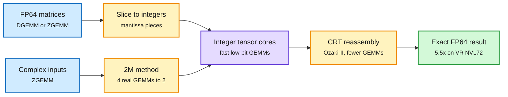

# cuBLAS Ozaki-II / 2M, and GLM-5.3 across two DGX Stations

## TL;DR

**cuBLAS (CUDA Toolkit 13.4.2)** now computes full-accuracy double-precision matrix multiplies on the GPU's integer tensor cores. It splits each FP64 number into integer slices, multiplies the slices on tensor cores, and reassembles the exact result. **Ozaki-II** needs fewer integer multiplications than Ozaki-I by using the Chinese Remainder Theorem. The **2M** method cuts a complex matrix multiply from four real multiplies to two. DGEMM with Ozaki-II runs **5.5x faster than native FP64 on Vera Rubin NVL72 and 3.9x on GB200**. ZGEMM with 2M runs 5x faster on GB200. End to end, CCSD quantum chemistry gets 2x (VR NVL72) and 1.4x (GB200) at full FP64, 5x and 3.5x in mixed precision; BerkeleyGW gets 6.6x and 3.9x. Rubin adds a TI16 numeric format and the `tcgen05.mma` instruction that speed up both Ozaki variants. No application code changes.

Separately, NVIDIA showed how to serve **GLM-5.3 NVFP4** (Z.ai's 753B MoE, 40B active, ~464 GB) when one GB300's 252 GB HBM3e is not enough: two DGX Stations over ConnectX-8 RDMA, tensor parallelism TP=2 in vLLM, with multi-token prediction, FP8 KV cache and prefix caching. Throughput peaked at **607.8 output tokens/s at concurrency 16** and fell to 385.0 at concurrency 32, with mean request latency of 453.5 s.

Exact FP64 from integer math

Precision is recovered by arithmetic, not by the hardware format.

Blue is input, amber is the decomposition and reassembly, purple is the tensor-core work, green is the exact result.

## Why it matters

- **The hardware roadmap stops having to choose.** Blackwell and Rubin cut native FP64 throughput in favour of low-precision AI formats. Ozaki emulation lets the same silicon serve HPC customers at full accuracy, which changes the "AI chips are bad for science" argument and the value of FP64-heavy competitors.
- **Same idea as low-bit AI training, opposite direction.** Inkling (same day) trains in 4 bits and accepts bounded error. Ozaki computes in low-bit integers and reconstructs exactness. Both say the format is a software decision layered on whatever the tensor cores do fastest.
- **GLM-5.3 on two Stations** shows the desk-side ceiling: a frontier-size open MoE in NVFP4 is just over one GB300's memory, so the cheapest "local" deployment is now two workstations and an RDMA link. Throughput falling from 607.8 to 385 tok/s between concurrency 16 and 32 suggests the TP link or KV capacity saturates early.

## Relation to prior wiki pages

- Extends [gpu-kernels](gpu-kernels.md) (Helion compile-time heuristics on 11-13 beat hand-written Triton by 18%) with a library-level win that needs no kernel authoring at all.
- Adds a data point to [memory-hierarchy](memory-hierarchy.md): NVFP4 halves weight memory, but a 753B MoE still overflows a single 252 GB HBM3e GPU, so the interconnect becomes the serving bottleneck, the same constraint Inkling's quantized all-to-all addresses in training.
