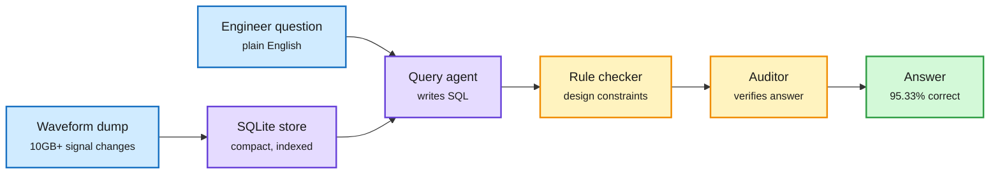

# BTTF: turn chip-simulation waveforms into a database agents can query

**TL;DR.** A Google DeepMind and Columbia paper targets the least automated part of chip design: post-simulation verification. Chip simulations log every signal change, and the waveform dumps can exceed 10 GB of text that engineers still scan by hand. No LLM context holds that, and the files have no query interface. The authors note that about 74.6% of LLM-for-EDA (electronic design automation) studies target RTL code generation, leaving waveform debugging largely untouched. BTTF converts the dumps into a compact SQLite database. A team of agents turns plain-English questions into SQL, checks design rules and audits each answer. On 150 expert-labelled verification questions it answers 95.33% correctly with Gemini 2.5 Pro. Splitting the work across specialized agents scored 17.3% higher on a quality audit than one agent, at 1.96x the latency.

Put the trace in a database, not in the prompt

The context-window problem is solved by changing the data format, not the model.

Blue is input, purple is the store and query agent, amber is checking, green is the verified answer.

## How it relates to prior wiki pages

- **Same move as** [Folio](../agentic-systems/2026-11-15-folio-context-folding.md) (11-15) and SkillCache (today): stop pushing raw bulk into the context and give the agent a structured handle instead.
- **Hardware angle.** Verification is the long pole of chip schedules. If agents can query simulation output, the bottleneck shifts toward simulation compute itself. Relevant to [compute-economics](compute-economics.md) only indirectly, but it is a rare agent paper aimed at the chip pipeline rather than at software.

## Gaps

- 150 questions, one model family (Gemini 2.5 Pro). No comparison against a human verification engineer's time to answer.
- The 1.96x latency cost of the multi-agent split is reported, but the token cost is not.

## Links

- Paper: https://arxiv.org/abs/2610.06790
- Post: https://x.com/rohanpaul_ai/status/2122114049353908599
- Raw: `raw/twitter/feed/2026-11-16-morning-ranked.json`
