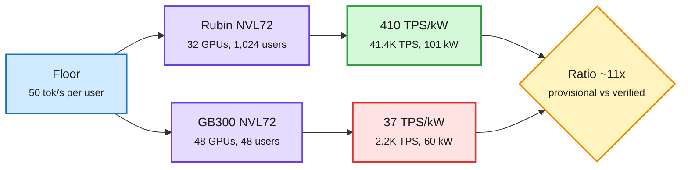

# Vera Rubin debuts in MLPerf, and NVIDIA's SC26 slate (Rubin HPC, DGX Spark kit, photonics at Lambda)

**Sources:** [MLPerf Training v6.1 blog](https://developer.nvidia.com/blog/nvidia-vera-rubin-nvl72-achieves-up-to-2x-blackwell-ultra-performance-in-mlperf-training-v6-1/) · [MLPerf Endpoints v1.0 blog](https://developer.nvidia.com/blog/nvidia-vera-rubin-nvl72-leads-agentic-inference-performance-on-mlperf-endpoints-v1-0/) · [Rubin HPC](https://blogs.nvidia.com/blog/rubin-hpc/) · [DGX Spark HPC Developer Kit](https://blogs.nvidia.com/blog/dgx-spark-hpc-developer-kit-sc26/) · [Lambda + NVIDIA Photonics](https://blogs.nvidia.com/blog/lambda-photonics/) (all NVIDIA, 2026-11-16) · raw: `raw/labs/2026-11-17-081848-labs.md`

## TL;DR

Vera Rubin NVL72's first MLPerf round. **Training v6.1:** fastest time to train on six of seven benchmarks, up to 2x per GPU over an optimized GB300 NVL72. DeepSeek-V3 671B (a MoE, mixture-of-experts, model) trained in 4.14 min on 1,024 Rubin GPUs against 8.03 min on 1,024 GB300s. Per-GPU gains: 2x DeepSeek-V3, 1.6x gpt-oss 20B and Llama 3.1 8B, 1.5x Llama 2 70B LoRA, 1.4x the new Qwen3.5 397B GRPO reinforcement-learning benchmark (10.44 min at 1,024 GPUs). Scaling efficiency stays above 97% from 256 to 1,024 GPUs over a copper NVLink 6 spine at 3.6 TB/s per GPU. GB300 at 10,240 GPUs still holds the absolute DeepSeek-V3 record. NVIDIA platforms ran 80% of closed-division submissions. **Endpoints v1.0 (provisional):** over 10x throughput per kilowatt versus GB300 NVL72 at a shared floor of 50 tokens/s per user on Kimi K3, and 5-10x across Kimi K3, DeepSeek-V4.1-Flash and Qwen3.6-35B-A3B. The footnote matters: the Rubin run used 32 accelerators at concurrency 1,024 (41,414 TPS, 100.89 kW), the GB300 run 48 accelerators at concurrency 48 (2,210 TPS, 60 kW). Both meet the interactivity floor, but GB300's verified result is a low-concurrency point and Rubin's is pending MLCommons review. Serving techniques named: prefix caching, state reuse, Dynamo routing, DeepSeek's MegaMoE kernel and Qwen multi-token prediction with Tensor Core verification.

**SC26 slate.** *Rubin HPC*: a separate Vera Rubin GPU with 50,000+ CUDA cores, sparse data acceleration and NVLink 7, aimed at simulation (sparse matrix, stencils, sort and reduce), due 2028. *DGX Spark HPC Developer Kit*: four GB10 nodes in a switchless ConnectX-7 ring, 512 GB combined memory and 20 TB NVMe, enough to serve a ~700B model in NVFP4 at a desk. *Lambda* runs NVIDIA Photonics co-packaged-optics switches (optical engines on the switch package instead of pluggable transceivers) across 10,000+ GB300 GPUs: 144 ports at 800 Gb/s, about 4% lower latency at rack scale and up to 10% at pod scale, a 36°C median optics temperature against 51°C for pluggables, and NVIDIA-claimed 5x power efficiency and 15x reliability with 4x fewer lasers.

How the 10x per-kilowatt claim is built

Same interactivity floor, very different operating points.

Blue is the shared constraint, purple is a system, green and red are the two efficiency points, amber is the comparison to treat with care.

## How this relates to prior wiki pages

- **Hardware context:** [Nvidia without Jensen](2026-11-13-nvidia-without-jensen.md) (11-13) and [AI financing stress after Huang](2026-11-14-ai-financing-stress-after-huang.md) (11-14). This is the first product cycle shown under interim CEO Colette Kress, the day before Q3 earnings. Ian Buck, who gave the SC26 address, is now discussed as a CEO candidate.
- **Confirms** the agent-serving pattern: MLPerf now has an agentic endpoint benchmark whose dataset grows context turn by turn, the same traffic shape as [today's prefix-cache posts](../inference-efficiency/2026-11-17-agent-sessions-prefix-cache-discipline.md).
- **Memory economics:** Rubin's gains ride HBM4; see the 11-16 Bernstein note that half of an HBM4 stack's cost is base die, packaging and test, and [memory hierarchy](memory-hierarchy.md).
- Concept pages: [compute economics](compute-economics.md), [GPU kernels](gpu-kernels.md).

## Open questions

- Endpoints throughput-per-kW comparisons depend on which concurrency each submitter chose. A matched-concurrency curve would be the honest view.
- Rubin HPC splits the line into AI and simulation parts. Whether FP64-heavy customers accept a 2028 date while AMD ships MI-series HPC parts now is open.
