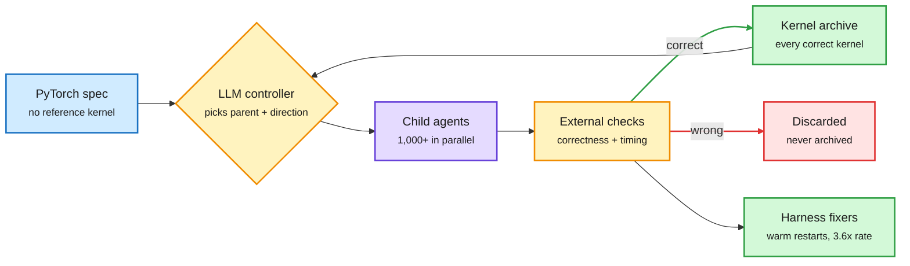

# CompoundingKernel: self-improving from zero to first on SOL-ExecBench (2611.19230)

**Sources:** [arXiv:2611.19230](https://arxiv.org/abs/2611.19230) (Amazon; Qu, Wang, Chen, Li, Liu, Li et al.) · [DAIR Academy pick (11-14)](https://academy.dair.ai/papers/compoundingkernel-self-improving-from-zero-to-first-2611.19230) · X ([@dair_ai](https://x.com/dair_ai/status/2122806742048448924), repost by [@omarsar0](https://x.com/omarsar0/status/2122843380401033515)) · LinkedIn (DAIR.AI repost) · raw: `raw/twitter/feed/2026-11-18-morning-ranked.json`

## TL;DR

Amazon's CompoundingKernel is a search system in which **over a thousand coding agents write GPU kernels from scratch**. As of 2026-11-11 its kernels rank **#1 on the public L1, L2 and Quantization boards of SOL-ExecBench on NVIDIA B200** (held on L1 since 10-27 except a short loss on 11-07). All 235 problems have a site-verified correct kernel, and on the 209 public problems they are **4.40x faster than the reference baseline**. Agents start from each problem's PyTorch definition only: no reference kernels, and official scores never enter the loop. Four loops run: a child agent edits one kernel in one direction; checks outside the model decide correctness; an **LLM controller** reads a per-problem archive of every correct kernel with its lineage and picks the next parent or a new design; and a team of agents fixes the harness itself at warm restarts. Humans only choose what to submit. At equal wall time the LLM controller beat a coded UCB-style tree search on 35 of 38 problems, not by picking better parents (it chose about as well) but by making **2.4x as many correct attempts**. One warm-restart fix raised the fleet's evaluation rate 3.6x. The paper's main finding: **the rate of reliable measurements, not the number of agents, limits how far the search scales.**

The archive and the verifier live outside the model

Agents propose; the archive remembers; external checks decide what counts.

Blue is the spec, amber are decisions, purple is the agent fleet, green is what is kept, red is discarded.

## Why it matters

- **Kernel writing is now a search problem bounded by evaluation throughput.** The bottleneck was not model quality or agent count but how many trustworthy correctness-plus-timing measurements per hour the fleet could run. That is a GPU-scheduling and harness-reliability problem.
- **LLM controller vs coded tree search:** same parent quality, more attempts. The win is throughput, which echoes the 11-17 [TokenEconomizer](../agentic-systems/2026-11-17-tokeneconomizer.md) and [Batch Makespan](../inference-efficiency/2026-11-17-batch-makespan-agent-workloads.md) finding that agent value is gated by scheduling and harness waste.

## Relation to prior pages

- **N-of-a-kind on agent-written kernels.** Anthropic's Mythos ported nearly all kernels to AMD MI355X in about three days ([11-12](2026-11-12-mythos-amd-port-and-kernel-library-failures.md); restated in its IPO roadshow this week); agents built SGLang's IBM Spyre plugin in under a week (11-13 update on [GPU kernels](gpu-kernels.md)); NVIDIA's Nsight AI Porting Agent sped a WRF routine 5x for ~150M tokens (SC26, 11-17). CompoundingKernel is the first to take a public leaderboard from zero.
- **Matches the self-improving-agents adoption-gate thread** ([agent shorts 11-17](../agentic-systems/2026-11-17-agent-shorts-memory-teams-evolution.md)): correctness is decided outside the model, which is the same move as EvoTrias hiding the scorer from the coder.
- Same-day HF benchmark [Accelerate Bench (2611.20882)](https://arxiv.org/abs/2611.20882) is the CPU-side counterpart: 16 coding agents optimizing whole scientific programs score 25.5-67.4%, and identical code runs 0.29x to well above 1x depending on how changes are coordinated.

## Gaps

- Fleet compute cost (GPU-hours for evaluation, tokens for 1,000+ agents) is not in the abstract; 4.40x over the reference baseline is not the same as 4.40x over expert-tuned kernels.
- Leaderboard rank is a moving target; overfitting to a board's timing harness is the obvious failure mode, and the paper keeps official scores out of the loop to limit it.

## Research angle

If evaluation rate is the binding constraint, the next gains come from cheaper proxies (static cost models, partial-shape timing, learned performance predictors) that rank candidates before a real GPU run. That turns kernel search into a routing problem: which candidates earn an expensive measurement.
