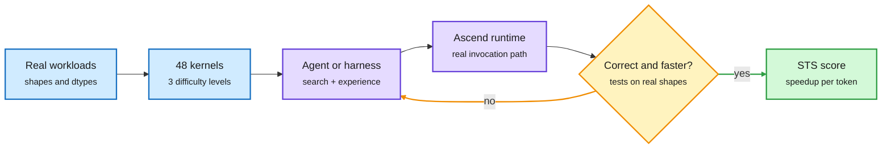

# AscendGYM (2611.17621) and TeleChat Xing4 (2611.22115)

**TL;DR.** The two most-upvoted papers on the 11-18 Hugging Face list are both about running frontier work on Huawei Ascend NPUs instead of NVIDIA GPUs. **AscendGYM** (SLAI) is a kernel-*optimization* benchmark, not a kernel-generation one: 48 existing Ascend kernels across three difficulty levels, each tested on dtypes and tensor shapes collected from real training and inference jobs, so a speedup maps directly to a workload. It ships a full execution environment, a built-in harness with search orchestration and experience accumulation, and a new metric, the **Speedup-Token Score (STS)**, which divides speedup by the token cost of getting it. **Xing4** (China Telecom's TeleChat lab, 154 upvotes, top of the day) is a 285B agentic MoE pretrained on 8,192 Ascend 910C cards with MindSpore HyperParallel, with no CUDA anywhere, plus an open 29B-A4B model with 256K to 1M context (per AI Weekly Espresso).

A kernel win only counts if you can afford the search

AscendGYM scores speedup per token spent, on shapes from real jobs.

Blue is the benchmark input, purple the agent and hardware, amber the check-and-retry loop, green the cost-normalized score.

## Xing4 systems details (from the abstract)

- Architecture study of sparse activation, attention design, depth/width and speculative decoding, framed as capacity versus compute, memory access and execution overhead on Ascend.
- Pretraining: topology-aware hybrid sharding, distributed optimizer execution, long-sequence and activation-memory management; **CPU affinity and core isolation** to cut host scheduling interference.
- Post-training: **TeleGym**, a unified agent platform with disaggregated asynchronous execution, bounded oversampling and partial rollout for tasks of uneven length.

## How it relates to prior wiki pages

- **Same lab lineage as [SLAI T-Rex](2026-07-23-slai-t-rex-deepseek-v4-ascend.md)**, which post-trained DeepSeek-V4 end-to-end on an Ascend SuperPOD. SLAI now ships the benchmark for the kernel layer underneath.
- **STS is the Ascend version of the cost-normalized kernel metric** the wiki has been tracking on NVIDIA: [CompoundingKernel (11-18)](2026-11-18-compoundingkernel-agent-kernel-search.md) found that trustworthy timing runs per hour, not model quality, limited a 1,000-agent kernel search. AscendGYM makes the token bill of that search part of the score.
- **Policy context:** the same day, Tencent's president said the new US remote-access chip rule "sets everyone back in China" and BIS was reported to have rushed H200 export approvals. Xing4 is the counter-signal: a 285B frontier-class training run that needed neither.
- Concept pages: [gpu-kernels](gpu-kernels.md), [compute-economics](compute-economics.md).

## Gaps

AscendGYM's initial suite is 48 kernels; no leaderboard numbers are in the abstract. Xing4's abstract gives no benchmark scores or MFU, so "frontier" is a claim about scale, not quality.

**Raw sources:** [AscendGYM](../../raw/huggingface/2026-11-18-ascendgym-a-cost-aware-kernel-optimization-benchmark-for-rea.md) · [Xing4](../../raw/huggingface/2026-11-18-telechat-to-xing4-advancing-frontier-agentic-models-on-domes.md) · [arXiv AscendGYM](https://arxiv.org/abs/2611.17621) · [arXiv Xing4](https://arxiv.org/abs/2611.22115) · [GitHub](https://github.com/SLAI-AITP/AscendGYM)
