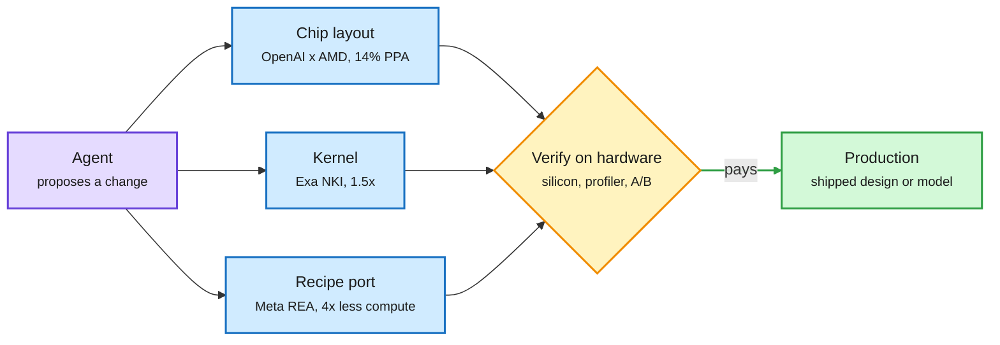

# Models design and tune the silicon (lab posts, 2026-11-18)

**TL;DR.** Four lab posts on the same day show AI agents working one layer below the model: on the chip, the kernel and the training recipe. **OpenAI** says its models found up to 14% PPA (power, performance and area, the three numbers every chip design trades against) on AMD flagship GPU IP in under five months, on designs AMD engineers had tuned for years; AMD has folded the changes into a design sent to production, and the same approach improved Jalapeño, OpenAI's first custom inference chip, with gains verified on real silicon (GPT-6 Astra was the model named). **Exa** re-embedded 30B documents on AWS Inferentia2/Trainium2 and reached about 1.5x throughput with an agentic development loop: weight-layout fixes, compiler autocast (gated at 0.999 cosine similarity), drop-in NKI attention, and a custom weight-stationary fused SwiGLU MLP kernel that removed HBM spill. **Meta** says agents now handle over 60% of "technique propagation" (porting a proven ranking-model improvement to other ads models), with 3x engineering productivity, a median 4x cut in training compute on select combinations and an estimated $45M+ compute savings this year. **NVIDIA's Daviator** batches k-point work in VASP with mixed FP32/FP64 precision for up to 22x faster time-to-solution and 75% lower cost than CPU.

The agent moved down the stack

Same loop at every layer: propose a change, verify it on real hardware, keep it only if it pays.

Purple is the agent, blue the layer it edits, amber the hardware check, green what ships.

## Why it matters

- **PPA gains compound across every token served.** A 14% PPA improvement on GPU IP is roughly a generation's worth of tuning; if it reaches production silicon it lowers cost per token for everyone buying AMD parts, not just OpenAI.
- **The verifier is the bottleneck, again.** Every success here has a hard checker: real silicon, a 0.999 cosine gate, production A/B. This repeats the [CompoundingKernel (11-18)](2026-11-18-compoundingkernel-agent-kernel-search.md) finding that trustworthy timing runs per hour, not model strength, limited a 1,000-agent kernel search.
- **Skeptic's note** (X feed): a fabless design is only as good as the fab capacity, HBM allocation and packaging behind it, which is why OpenAI's Broadcom deal matters more than the GDSII file.

## How it relates to prior wiki pages

- **Extends** the 11-11 to 11-18 [gpu-kernels](gpu-kernels.md) thread ("orchestration becomes the programming model") from kernels to physical design.
- **Pairs with** [AscendGYM (same day)](2026-11-19-ascendgym-and-xing4-ascend-stack.md), which prices agent kernel search in tokens.
- **OpenAI's own data** ([research acceleration post](../ai-industry/2026-11-19-anthropic-ipo-and-ai-research-acceleration.md)) says agents succeed 79% of the time monitoring training runs but only 25% writing inference and serving code: the layer these posts celebrate is the one agents are weakest at in general, which makes the verifier-heavy setups above the exception, not the rule.

**Sources:** [OpenAI chip design](https://openai.com/index/advancing-chip-design-with-our-models/) · [The Decoder](https://the-decoder.com/openai-says-its-models-delivered-a-years-worth-of-chip-optimization-on-top-of-amds-own-engineering/) · [Exa on AWS](https://aws.amazon.com/blogs/machine-learning/exa-boosts-embedding-throughput-by-50-to-index-billions-of-documents-on-aws-ai-chips/) · [Meta REA](https://engineering.fb.com/2026/11/18/ml-applications/ai-agents-to-scale-ml-innovations-across-ads-ranking-models/) · [NVIDIA Daviator](https://developer.nvidia.com/blog/tackling-gpu-bottlenecks-in-plane-wave-dft-with-k-point-batching-and-mixed-precision/) · raw: [labs 11-18 23:28](../../raw/labs/2026-11-18-232859-labs.md), [labs 11-19 11:12](../../raw/labs/2026-11-19-111240-labs.md)
