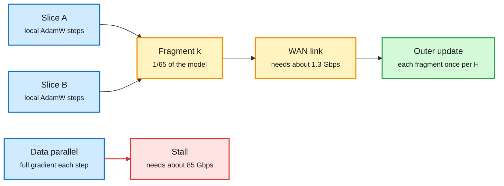

# Training and serving plumbing: Streaming DiLoCo, Dynamo for RL, OpenAI's Performance Factory (2026-11-20)

**TL;DR.** The lab feeds carried a cluster of infrastructure posts that all attack idle GPU time rather than FLOPs.

- **Streaming DiLoCo in MaxText (Google).** DiLoCo (Distributed Low-Communication training) lets each datacenter-scale group run H local optimizer steps before syncing. Vanilla DiLoCo still sends the whole model every H steps, so the link spikes. Streaming DiLoCo splits the model into P fragments and syncs one per step. For Qwen3-32B on 2x TPU v5p-32, plain data parallelism needs about 85 Gbps sustained cross-slice bandwidth (524 Gb per ~6.2 s step); streaming DiLoCo with P = H = 65 sends about 1.0 GB per step, needs about 1.3 Gbps, and fits inside the step time even on a throttled 10 Gbps link. 65x less traffic than data parallelism.
- **NVIDIA Dynamo for RL rollouts.** RL post-training is mostly inference: workers generate rollouts, the trainer scores them and ships new weights back. Dynamo adds KV-aware routing (send a rollout to the worker that already caches its prompt), ModelExpress (load weights from a running worker's GPU memory and send compressed deltas instead of full checkpoints) and failure rerouting. CoreWeave reports up to 15x faster weight updates; H Company up to 20% shorter training steps and 5% fewer GPU-hours. Microsoft uses it for rollout inference.
- **OpenAI's Performance Factory.** Latency alerts on ChatGPT launch Codex agents that read logs and recent code changes, a second agent tries to refute the diagnosis, and a third drafts a fix for a human to approve. About 17 investigations a day with 70% judged accurate, but of 600+ diagnosed problems only about 15 agent fixes shipped unchanged (per a summary on X).
- **Also:** SageMaker now flags week-over-week latency drift, idle GPUs and missing serving optimizations on vLLM endpoints by default; Together's Storage Accelerator caches objects on every GPU node (about 20x faster warm reads, 0.64-0.72 s vs 12.7-15.0 s for a 2 GiB object from cross-cloud R2); CriticNPU (2611.24733) uses a roofline critic to reach best-or-tied latency in 74% of prefill and 87.5% of decode NPU design settings with half the simulator calls.

Streaming DiLoCo flattens the sync spike

Same total traffic as vanilla DiLoCo, but spread over every step.

Blue is compute, amber is the streamed sync, green is the outer update, red is the data-parallel stall it avoids.

## Relation to prior wiki pages
- Dynamo's KV-aware routing is the same mechanism SageMaker shipped for serving on 11-18 ([routing goes cache-aware](../ai-routing/2026-11-18-routing-goes-cache-aware-and-open-weight.md)); now it is inside the RL training loop.
- The Performance Factory's numbers (good diagnosis, weak fixes) match [CompoundingKernel (11-18)](2026-11-18-compoundingkernel-agent-kernel-search.md): agents help most where correctness is decided outside the model.
- Cross-metro training is the training-side answer to the power and siting limits on the [compute economics page](compute-economics.md).

## Sources
- [Streaming DiLoCo](https://developers.googleblog.com/distributed-llm-training-across-metros-streaming-diloco-in-maxtext/) · [Dynamo for RL](https://developer.nvidia.com/blog/reducing-rollout-bottlenecks-in-reinforcement-learning-with-nvidia-dynamo/) · [Performance Factory](https://openai.com/index/how-openai-performance-factory-keeps-chatgpt-fast) · [SageMaker drift](https://aws.amazon.com/blogs/machine-learning/amazon-sagemaker-ai-now-detects-latency-drift-idle-gpus-and-missed-optimizations-on-your-inference-endpoints/) · [Together TSA](https://www.together.ai/blog/introducing-together-storage-accelerator) · [CriticNPU](https://arxiv.org/abs/2611.24733)
- raw: `raw/labs/2026-11-20-103425-labs.md`, `raw/twitter/feed/2026-11-20-morning-ranked.json`

Concept pages: [compute economics](compute-economics.md) · [GPU kernels](gpu-kernels.md) · [memory hierarchy](memory-hierarchy.md)
