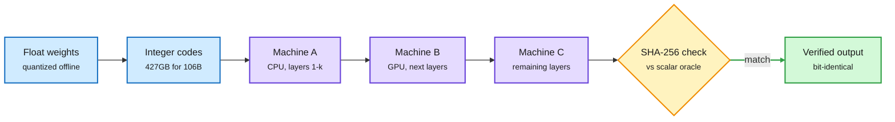

# KernelShift and tritify

## KernelShift ([2611.29590](https://arxiv.org/abs/2611.29590))

Hardware keeps adding instructions, and the best way to write a kernel changes with each generation. KernelShift asks whether coding agents can use **new, unfamiliar instruction-set extensions**. An agent-assisted, human-verified pipeline turns real repositories (ncnn, llama.cpp, Arm SIMD Loops, KleidiAI) into 99 kernel tasks, some taken from real LLM executions, with feedback from the target hardware. Agents are tested across successively newer Arm extensions: Neon, SVE, SVE2 and SME2.

- On established extensions agents beat the compiler's auto-vectorization everywhere (2.4 to 19.8x) and beat ncnn's Neon kernels by up to 2.74x.
- They still lose to Arm's hand-tuned KleidiAI kernels (0.70x).
- End to end, agent-written kernels give **1.3 to 1.6x prefill speedup over llama.cpp's fast path** on two LLMs.
- They **do not reliably adapt to SME2's matrix tiles**, the extension that needs a new programming model.

The headline is the last bullet. Agents are good at known idioms and weak at the new abstraction, which is exactly where hardware value appears first.

## tritify ([2611.13730](https://arxiv.org/abs/2611.13730), code: [pelloran-inc/tritify](https://github.com/pelloran-inc/tritify))

Floating-point inference is not reproducible: the same model gives different bits on different hardware, compilers or thread counts. tritify runs the whole runtime forward pass of real models (decoder LLMs, MoE decoders, SAM 2.1) in **exact integer arithmetic**. Float appears only in offline quantization and the reference used for checking.

- Bit-identical output run to run, across CPU instruction sets and across CPU and GPU, checked with a SHA-256 of the output.
- Reproduces the float reference's decisions on tested models; per-layer fidelity through 16 layers of OLMoE-1B-7B and a 106B MoE shows no cliff.
- **Location independence:** GLM-4.5-Air (106.9B parameters, 427GB of integer codes) generated its answer across three machines, none able to hold the codes in RAM, bit-identical to a single-host run.
- Consequence: **verifiable distributed inference**, where an untrusted server runs the model and a scalar oracle re-derives the exact bytes. Defending against a dishonest server is future work. No speed-up is claimed.

Same integer codes, same bytes, on any machine

tritify makes the output a hash you can check, which is what a verifiable provider needs.

Blue is the quantized model, purple are machines of different types, amber is the hash check, green is the verified result.

## Relation to prior wiki pages

- **KernelShift extends** [gpu-kernels.md](gpu-kernels.md) (11-18: agents took a kernel leaderboard from zero; 11-19: kernel search priced in tokens) to CPUs and to the question of new hardware. It is the first benchmark that scores adaptation across hardware generations rather than one fixed target.
- **tritify connects** to the 11-23 Looking Ahead bet that an aggregator launches provider attestation within 90 days, after Dragos found key-stealing cheap providers ([11-23 supply chain](../ai-industry/2026-11-23-inference-supply-chain-and-market.md)). Bit-exact integer inference is one technical route to checking what a provider actually ran, though tritify does not yet stop a dishonest server.
- **Relates to** the gpu-kernels 11-17 note "bits must match": determinism is becoming a requirement, not a nicety.
