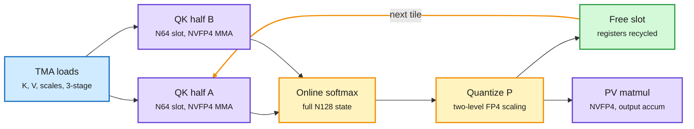

# NVFP4 attention on RTX Blackwell through register recycling

**TL;DR.** On the workstation Blackwell part (RTX PRO 6000, SM120), BF16 attention is bound by matrix-multiply throughput, not by softmax as on the data-center B200. So the win is to run attention's two matmuls in NVFP4 (4-bit floats with FP8 block scales), which SageAttention3 already does. NVIDIA's post (Atharva Joshi) finds SageAttention3 still leaves the Tensor Cores idle while consumer warps do softmax and re-quantize probabilities, and it cannot simply double-buffer the score tile because registers are 95.3% full. The fix splits each 128-wide score tile into two 64-wide register slots and reuses a slot for the next tile's QK matmul as soon as its half has been exponentiated and packed to NVFP4. Result: up to **1.64x lower attention-kernel latency** on RTX PRO 6000 Blackwell and **up to 15.34% end-to-end latency** cut in Reactor's production serving of world models (LongLive, Helios, OmniDreams, Cosmos 3 Nano). Merged into FlashInfer main.

Half a score tile is enough to keep the Tensor Cores busy

The registers freed by quantizing one half are reused for the next tile's QK, so no second buffer is needed.

Blue is data movement, purple is Tensor Core work, amber is the softmax and quantize chain, green is the recycled register slot.

## Mechanism

- **Why NVFP4 here.** RTX Blackwell has lower BF16 matmul throughput than B200, so BF16 attention is MMA-bound there. NVFP4 Tensor Cores have far more TFLOP/s, so moving both QK and PV to FP4 raises the ceiling.
- **SageAttention3 baseline.** 4 producer warps load Q once and K, V, scale factors and a delta correction through a 3-stage TMA pipeline. 8 consumer warps run QK, masking, online softmax, NVFP4 quantization of the probabilities P and then PV, strictly in sequence per N128 tile. P lives in [0, 1], which wastes FP4 dynamic range, so SageAttention3 uses two-level scaling (renormalize, then quantize).
- **The ISA constraint.** The SM120 block-scaled FP4 MMA is `m16n8k64`, so a k=128 contraction needs two synchronous MMA issues. While consumer warps do softmax and quantization, nothing is queued on the Tensor Cores.
- **The register constraint.** Producers use 3,072 registers and consumers 59,392, about 95.3% of the SM. There is no room for a second full score tile, which is what a FlashAttention-3-style ping-pong would need.
- **The fix.** Keep full N128 K/V tile loads (TMA is shaped for 128x128). Split the score tile into two N64 halves in separate register slots. Update online-softmax state over the whole N128 tile first, then, as each half finishes exponentiation and FP4 packing, reuse its registers for the corresponding QK half of the next tile. Adjacent tiles interleave without extra storage.

## Relation to prior wiki pages

- **Extends** the [GPU kernels](gpu-kernels.md) thread: the data-center answer to attention's softmax bottleneck was FlashAttention-4 (pipelining plus exp2 emulation). This is the workstation answer, where the bottleneck is the opposite one. The same "overlap the non-matmul work with the next matmul" principle, applied under a register budget instead of a shared-memory budget.
- **Confirms** the low-bit attention line in [quantization](../inference-efficiency/quantization.md): the 09-17 VC-Attention page (low-bit value smoothing) and the 05-19 LongLive 2 NVFP4 page both showed FP4 attention holds quality on video models. This page is the scheduling follow-up: once FP4 attention is accurate, the kernel is limited by the quantize step it introduced.
- **Contrasts** with [KernelShift (11-25)](2026-11-25-kernelshift-and-tritify.md), which found agents fail to adapt to Arm SME2's new matrix-tile programming model. This optimization is exactly that kind of hardware-specific tile scheduling, and it was hand-written.

## Gaps

- Kernel numbers are "up to"; no sequence-length or head-dim sweep is in the captured text.
- No accuracy table beyond "compare against a BF16 baseline" in the next steps.
- SM120 only. Whether the same trick helps B200, where softmax not MMA is the bound, is not addressed.

Raw: [labs capture](../../raw/labs/2026-11-26-103435-labs.md)
