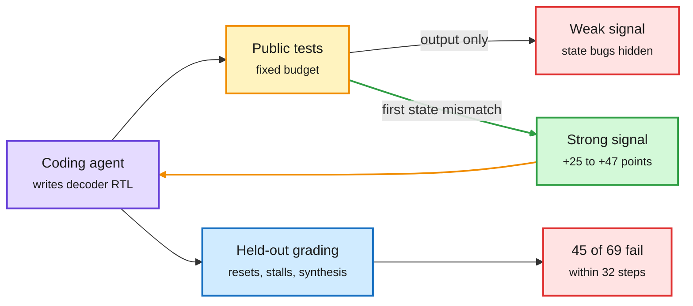

# AIChipBench

**TL;DR.** Agents write synthesizable RTL (register-transfer-level hardware code) for quantized Qwen3.5, Gemma 3/4 and Llama 3.2 decoders, checked against an integer reference that fixes both the outputs and the stored state at every decoding step. The hard part is state: a decoder carries state between tokens, so a wrong update can leave this token right and corrupt one several tokens later. Across 9,136 attempts by four coding agents, pointing feedback at the first state mismatch raised acceptance by 25.0-46.9 points in all 12 agent-task cells and halved agent-hours per accepted design. But 45 of 69 accepted designs failed within 32 steps when regraded on new sequences.

Passing the output test is not passing the design

State-level feedback is what moves acceptance; held-out sequences expose the rest.

Purple is the agent, amber is the test loop, green is the feedback that works, red is what still fails.

## Key findings

- Difficulty lives in stored state (KV and decode registers), not arithmetic.
- First-state-mismatch feedback beats output-only feedback in every one of 12 agent-task cells, +25.0 to +46.9 points, and halves agent-hours per accepted design.
- 45 of 69 accepted designs fail on fresh sequences within the 32 steps the tests required: development tests are far too short.
- More than a third of speed-up attempts on a correct design (second track, near-fixed area) end without one.
- Overall ranking: Sol 5.6 and Fable 5.1 above Astra 6 and Opus 5.5, stable across all 200 random instance splits.

## How it relates to prior wiki pages

- **Same lesson as KernelBench-style agent work** (KernelShift, 11-25): agents recombine known idioms and stall on new abstractions; here the new abstraction is cross-step state.
- **Mirrors Anthropic's Rust migration** (11-26): tests said 98% done while production parity was 25%. Both say the verifier, not the generator, is the bottleneck.
- **Confirms** the 11-26 Looking Ahead call that agent benchmarks need repeated-run and held-out reliability numbers: 65% of accepted designs fail held-out.

## Gaps

Small edge-scale decoders only; no timing closure on a real process node; four agents.

Related: [gpu-kernels](../inference-efficiency/gpu-kernels.md) · [agent-benchmarks](../agentic-systems/agent-benchmarks.md) · [compute-economics](compute-economics.md)
