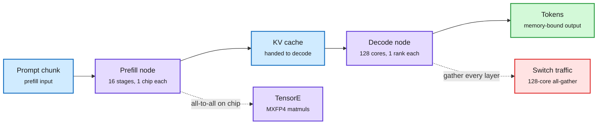

# AWS Challenger: Trainium3 inference and microarchitecture

**TL;DR.** SemiAnalysis put Trainium3 on InferenceX (its open inference benchmark that plots throughput per dollar of all-in TCO against per-user speed) and on AgentX (replayed real coding-agent sessions). Trainium3 with vLLM beats every accelerator except Vera Rubin on perf per TCO dollar across the whole interactivity curve. At 135 tok/s/user it yields a modeled 73.5% gross margin versus 53% for GB300 + SGLang, despite having only 17% of Blackwell Ultra's FP4 flops (2,517 vs 15,000 TFLOPS) and half its HBM (144GB). The reason is that decode is memory-bound, and Trainium3 has 61% of GB300's bandwidth (4.9 vs 8.0 TB/s) at about 30% of the TCO. The same week, Andy Jassy said Amazon's chips business (Trainium plus Graviton) is a $25B+ run-rate and that most of Bedrock's inference runs on Trainium.

Prefill is a pipeline, decode is a flat sheet of 128 cores

The same 16-chip node is laid out two different ways, each matching what the hardware is good at.

Blue is data, purple is compute, green is output, red is the cross-switch cost that decode pays on every layer.

## Key findings

- **Economics.** Best perf per TCO dollar of any shipping accelerator except Vera Rubin across the TCO vs p90 interactivity frontier. 73.5% modeled margin at 135 tok/s/user (Z.ai list prices, 60% fleet utilization, 3-year rental) vs 53% for GB300 + SGLang. TTFT lags GB300 because prefill is compute-bound.
- **"Short King" thesis.** 144GB HBM per chip is enough: extra HBM only pays if it buys throughput at the target latency. SemiAnalysis argues this is why 4-Hi stacks are attractive and next-gen parts mostly use 8-Hi.
- **Serving layout.** Prefill cuts the model into 16 pipeline stages (one chip each) and keeps tensor and expert parallelism inside a chip, because all-to-all (the MoE pattern) slows once it leaves the chip. Decode spreads one model copy across all 128 NeuronCores as separate expert-parallel ranks (two routed experts per core for GLM-5.3).
- **Microbenchmarks.** Static-descriptor DMA hits 80-89% HBM utilization at 64 KiB messages, which SemiAnalysis says Nvidia cannot do at small sizes. The 128x128 systolic TensorE fits a latency model of N+393 cycles, and M (the batch dimension that is small at decode) does not affect latency or throughput. Quad-MXFP8 reaches 4x BF16 throughput only for N>128. Under full-chip load MXFP8 throttles to 68.6% MFU, while BF16 stays near peak and FP8/MXFP4 run around 90%.
- **FlashAttention support.** VectorE now computes exponentials at 2-4 elements per cycle per lane, with built-in max-subtraction and running sums for stable softmax.
- **Profiler.** SemiAnalysis calls Trainium's profiler the industry's best and says Anthropic's performance engineers prefer it to Nvidia's.

## How this relates to prior wiki pages

- **Completes the 10-24 training post** ([Trainium3 training deep dive](2026-10-24-semianalysis-trainium3-training.md)), which found Trainium3 beats GB300 matmul MFU only in the 1-100 GFLOP band. Today's inference results show where that small-shape strength turns into money: decode.
- **Confirms the decode-is-where-ASICs-compete reading** on [compute-economics](compute-economics.md) and OpenAI's Jalapeño result (an ASIC beating Rubin on tokens per megawatt).
- **Extends the Amazon/Decart thread** (10-12, 11-22: Amazon buying Decart for more tokens per kilowatt on Trainium). Jassy's "majority of Bedrock is Trainium" is the demand side of that bet.
- **Tension with Goldman's HBM forecast** (11-27: HBM to $200B in 2027 on price). If half-capacity HBM wins on margin, the price-led thesis meets a capacity-per-chip ceiling for inference parts.

Related: [memory-hierarchy](memory-hierarchy.md) · [gpu-kernels](gpu-kernels.md) · [quantization](../inference-efficiency/quantization.md)
