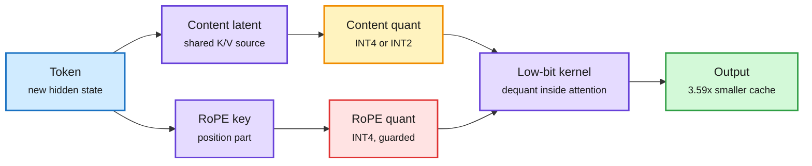

# QuantMLA: INT4 (and INT2) for both halves of the MLA cache

**Source:** HuggingFace Daily Papers, 2026-10-12 · [arXiv 2609.36760](https://arxiv.org/abs/2609.36760) · raw: `raw/huggingface/2026-10-12-quantmla-function-aligned-dual-path-quantization-for-low-bit.md`

## TL;DR

MLA (Multi-Head Latent Attention, the DeepSeek-style attention that stores one small latent per token instead of full keys and values) already shrinks the KV cache. But the cache still grows linearly with context and batch, and MLA stores two different things per token: a compressed **content** latent and a small **decoupled RoPE key** (the part that carries position). QuantMLA models how quantization error in each path distorts the attention output, finds that RoPE-path error is amplified far more than content-path error, and learns a separate transform for each path that can be folded into the weights offline. Result: the first reported joint INT4 caching of both paths with minimal loss, content cache at INT2 with RoPE keys at INT4 still competitive on reasoning and code, 3.59x physical cache compression at 128K, and 5.17x whole-job output throughput over BF16 under a cache-pressure serving workload. Code "upon acceptance".

Two cache paths, two error budgets

Position error hurts more than content error, so each path gets its own transform and bit width.

Blue is input, purple is cache state and the kernel, amber is the aggressive path, red is the error-sensitive path, green is the result.

## Key findings

- **Error model.** Content-path error enters through both query-key matching and value aggregation; RoPE-path error distorts the positional part of the attention logits and is amplified. Treating the two as one tensor (what generic KV quantizers do) wastes bits on the wrong side.
- **Function-aligned objectives.** Content path: reconstruct the attention *output*. RoPE path: reconstruct the positional QK logits, with a theoretical bound on output distortion. Both transforms live in spaces that preserve full-precision computation and fuse into model parameters offline, so there is no online rotation cost.
- **Bits:** joint INT4 on four MLA model families with minimal degradation; INT2 content + INT4 RoPE stays competitive on hard reasoning/code.
- **Systems:** a native low-bit MLA attention kernel unpacks and dequantizes inside attention; 3.59x physical compression at 128K, 5.168x whole-job output throughput vs BF16 under cache pressure.

## Relation to prior wiki pages

- **Extends** the [MLA/radix/KVShare frontier page (09-07)](2026-09-07-kv-cache-frontier-mla-radix-kvshare.md), which treated MLA's latent as the end state of KV compression. QuantMLA shows the latent still has ~4x of slack in bits.
- **Confirms** the October rotation thread on the [quantization page](quantization.md): PrismQuant (10-01, rotate the top activation eigenspace into a free subspace), WUSH-KV (10-02, data-fitted rotations to 2-bit KV) and now QuantMLA all fit transforms to the *function* the quantized tensor serves, not to generic outlier removal. Third paper in two weeks: a pattern.
- **Parallels** QuantWM (10-06), which found 2-bit keys flip *which* tokens a query selects. QuantMLA's RoPE-path amplification is the same failure in a different place: position and selection are the fragile parts of the cache.

## Gaps

Code not released. No per-position long-context retrieval test (needle-style), which is where 2-bit content error would show first. Throughput gain is under a cache-pressure workload; at low batch the win will be smaller.

## Related

[kv-cache](kv-cache.md) · [quantization](quantization.md) · [attention-mechanisms](../llms-foundation-models/attention-mechanisms.md)
