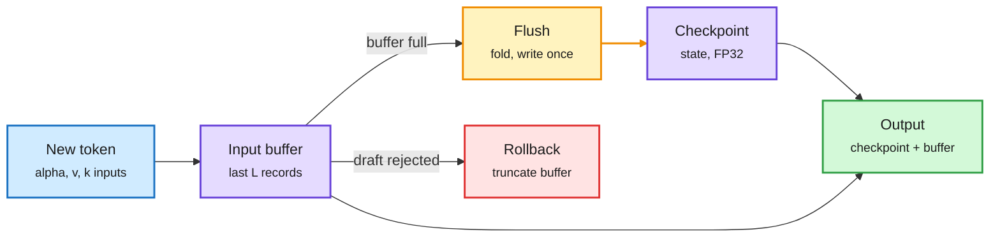

# ReplaySSM: cache the SSM inputs, not the state

**Source:** NVIDIA Developer blog (lab watcher), 2026-10-12, with the Dao AI Lab at Princeton · [Blog](https://developer.nvidia.com/blog/replayssm-rethinking-state-storage-for-faster-hybrid-model-decoding/) · raw: `raw/labs/2026-10-13-000834-labs.md`

## TL;DR

Hybrid models (Nemotron 3, Qwen3.5-3.8, Kimi-K3, GLM-5.3-Flash) interleave a few attention layers with many SSM layers (state-space layers such as Mamba-2 or Gated DeltaNet that compress history into a fixed-size state instead of a growing KV cache). At serving batch sizes, those SSM layers, not attention, become the decode bottleneck up to ~100K tokens: each step loads and stores the full state from HBM while doing little math. ReplaySSM rewrites the recurrence over a short window as *checkpoint + buffer of recent inputs*. Most steps only append the new inputs and compute the output from checkpoint plus buffer; every L steps (L=16) a flush folds the buffer into a new checkpoint and writes it once. Outputs match conventional decoding up to float error. Already integrated in TensorRT-LLM, vLLM and FlashInfer, and in production in GLM-5.3-Flash and Kimi-K3.

Write the state once per window, not once per token

The output only needs a read; the expensive write moves to a flush every 16 tokens.

Blue is the incoming token, purple is stored state, amber is the periodic flush, green is the per-step output, red is the speculative-decoding rollback.

## Key findings (vendor-reported)

- **Why SSMs are the bottleneck:** Nemotron-3-Super has 5x more SSM than attention layers, and one layer's FP32 state is 4 MiB per sequence, the size of an FP8 attention KV cache at ~8K tokens.
- **Traffic:** reads stay every step, writes drop to once per window, roughly halving state traffic. Kernel 1.46-1.80x faster and decode step 1.20-1.47x faster at batch 256 on B300/H100 across four models. **No speedup at batch 1.**
- **Speculative decoding:** rollback becomes "truncate the buffer" instead of storing a full state snapshot per draft token. 1.85-2.10x higher speculative throughput on 120B-class models.
- **Quantized state without drift:** keep a high-precision checkpoint for the recurrence and a low-precision copy for reads, so rounding error never re-enters the update loop. Three of four models within ~2 points of FP32 on GPQA-Diamond.

## Relation to prior wiki pages

- **Gap-filling for STEPQuant (10-09)**, [which quantized the recurrent state itself by allocating bits to error lifetime](2026-10-09-stepquant-recurrent-state-quantization.md) and noted that state error compounds because the state is rewritten every token. ReplaySSM attacks the same compounding from the systems side: never feed the low-precision copy back into the recurrence. The two are composable.
- **Extends the 10-09/10-10 "never discard state the next step rebuilds" rule** on the [kv-cache page](kv-cache.md) to the SSM state: here the trick is the opposite, never *write* state the next step does not need yet.
- **Speculative decoding on hybrids** was an open problem on the [speculative-decoding page](speculative-decoding.md): every method there assumed attention's free rollback. This is the first production fix.

## Gaps

Blog plus paper by the vendor; independent reproduction pending. Gains depend on batch size; edge and single-user serving see nothing. Window size L=16 was tuned per model.

## Related

[kv-cache](kv-cache.md) · [speculative-decoding](speculative-decoding.md) · [gpu-kernels](../hardware/gpu-kernels.md) · [Priming (10-13)](../llms-foundation-models/2026-10-13-priming-hybrid-ssm-from-transformers.md)
