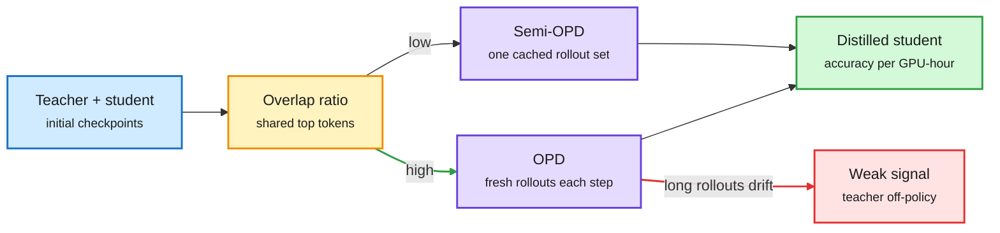

# When on-policy distillation is the wrong default: Semi-OPD, relative policy transfer, SynthSelf, UTT

**Source:** HuggingFace Daily Papers, 2026-10-12 · raw: `raw/huggingface/2026-10-12-when-do-we-need-on-policy-distillation-distilling-on-offline.md`, `...-rethinking-relative-policy-differences-transfer-of-on-policy.md`, `...-continually-post-training-small-models-via-synthetic-self-di.md`, `...-universal-textual-teaching-for-llms.md`

## TL;DR

Four same-day papers push back on on-policy distillation (OPD: the student generates its own answers and the teacher grades every token) as the universal recipe.

- **Semi-OPD** (NVIDIA + UCLA, [arXiv 2610.11291](https://arxiv.org/abs/2610.11291)). Generate student rollouts **once**, from the initial student, cache them, and distil on that fixed set. Across 17 teacher-student pairs (1.5B to 235B), Semi-OPD beats OPD in 14, by up to +13.6% accuracy with up to 11.4x faster training. The deciding variable is **initial teacher-student alignment**, measured as the overlap of their top next-token sets on the student's responses. OPD only wins when overlap is high. For misaligned pairs, the evolving student's long rollouts drift off the teacher's distribution, so the teacher's per-token signal gets weaker the longer the response.
- **Relative policy differences** ([arXiv 2610.13205](https://arxiv.org/abs/2610.13205)). Instead of copying the teacher, transfer the *difference* between an expert and a reference model (log-prob ratio as an implicit reward). Differences created by task training (RL or SFT) transfer reliably; differences created by **scale alone transfer weakly or not at all**. A stronger teacher is not automatically a better one.
- **SynthSelf** ([arXiv 2610.13113](https://arxiv.org/abs/2610.13113)). Continual post-training for small on-device models: forgetting tracks distribution shift linearly, so a minimally larger same-family "aligner" rewrites new data into the small model's own distribution. Beats six methods including on- and off-policy distillation on 4 acquisition and 14 retention benchmarks.
- **Universal Textual Teaching** ([arXiv 2610.12114](https://arxiv.org/abs/2610.12114)). No weight update: distil the teacher-student gap into a reusable natural-language "Primer". Student KernelBench accuracy 9.4% to 48.6% (fast_1 9% to 35%), Omni-MATH-2 27.6% to 51.7%, and the Primer transfers to students that never took part.

Check alignment before paying for on-policy rollouts

One cheap overlap measurement decides whether fresh student rollouts help or hurt.

Blue is the starting pair, amber is the alignment check, purple is the training recipe, green is the result, red is the failure mode.

## Relation to prior wiki pages

- **Pattern now at n=5 in one week:** [OPPD (10-07)](2026-10-07-oppd-power-distillation-and-base-model-cues.md) distils the teacher's sharpened mode; the [teacher-as-reward cluster (10-09)](2026-10-09-opd-teacher-as-reward-cluster.md) showed OPD is RL with the teacher as an implicit reward and collapses into long repetitive outputs when that reward misaligns; [OPD skills-not-knowledge (10-10)](2026-10-10-opd-skills-not-knowledge.md) showed reverse-KL OPD transfers skill but not facts. Semi-OPD gives the 10-09 collapse a **cheap pre-flight test** (overlap ratio) and a cheap fix (stop refreshing rollouts). The relative-difference paper gives 10-10's "no new facts" a cousin: scale-only gaps do not transfer.
- **Contradicts the default** in the [knowledge-distillation page](knowledge-distillation.md) since Thinking Machines' 2025 OPD post, that on-policy sampling is always worth its rollout cost.
- **UTT** extends harness-aware distillation (10-07): knowledge can move as text through the harness instead of through weights.

## Gaps

Semi-OPD's 17 pairs are math/reasoning heavy; agentic and long-tool-call trajectories (where drift is worst) are untested. The overlap threshold is reported as a correlation, not a calibrated cut-off. UTT's KernelBench numbers come from one teacher family.

## Related

[knowledge-distillation](knowledge-distillation.md) · [rl-for-llms](../llms-foundation-models/rl-for-llms.md)
