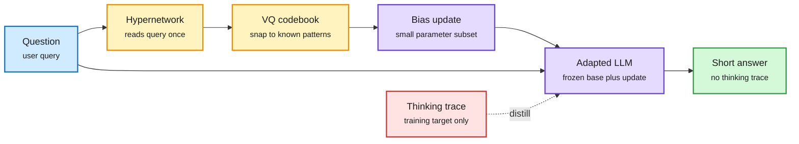

# HyperThink: turn the thinking trace into a one-shot weight update

**Date:** 2026-10-14 · **arXiv:** [2610.03039](https://arxiv.org/abs/2610.03039) (KAIST, NYU) · **Source:** HuggingFace Daily Papers 10-13 · **Raw:** [HF file](../../raw/huggingface/2026-10-13-hyperthink-text-to-parameter-hypernetworks-for-efficient-rea.md)

## TL;DR

Long chain-of-thought helps reasoning but costs latency, because every thinking token is decoded one after another. HyperThink argues the trace helps mainly because it makes the model's computation depend on the specific query, not because of the words themselves. So it replaces the trace with a query-specific parameter change. A small hypernetwork (a network that outputs weights for another network) reads the question once and predicts an update to a small set of the frozen base model's bias parameters. A vector-quantized decoder snaps that update onto a finite codebook of reusable patterns, which the authors say improves robustness and transfer to unseen problems. Training is self-distillation: the adapted model, with no trace, is trained to match the base model's response after it read its own thinking trace. At test time the model writes a short step-by-step answer with no thinking block. The paper reports the strongest gains in the low-latency, near-non-thinking region of the accuracy-latency curve on math and general reasoning.

The trace is paid for once, at training time

At inference, one hypernetwork pass replaces thousands of sequential thinking tokens.

Blue is the query, amber is the hypernetwork path, purple is the model, red is the expensive trace that only exists at training time, green is the answer.

## Key points

- **What is adapted:** selected bias terms, not full weights or LoRA matrices, which keeps the hypernetwork's output small.
- **Why vector quantization:** a free continuous update overfits; a finite codebook forces queries to share update patterns, a form of regularization.
- **Where it wins:** the near-non-thinking regime. It is not a replacement for long thinking on the hardest problems; it is a better floor when latency is fixed.

## How it relates to prior wiki pages

- **New branch of [parametric context internalization](parametric-context-internalization.md):** that page tracks hypernetworks that turn a document (Code2LoRA, Video2LoRA) or a spec (Compile by Training, 09-04) into weights. HyperThink is the first entry that internalizes the model's *own reasoning*, per query. Kurate's cs.AI #15 this week, **Internalizer** (portable context-to-parameter mapping for very large models, [arXiv 2610.11715](https://arxiv.org/abs/2610.11715)), is the same family at larger scale.
- **Complements [ELR (10-13)](../llms-foundation-models/2026-10-13-elastic-latent-recurrence-koi.md)**, which makes loop count a per-request compute dial without growing the KV cache. Both move query-dependent computation out of output tokens: ELR into extra depth, HyperThink into a weight delta.
- **Pairs with Thinking Inertia (10-13, same HF list)**, which finds that models keep emitting visible inference even when told not to think. HyperThink trains the no-trace behavior in rather than prompting for it.

## Gaps

- The abstract gives no model sizes or numbers; the gains are described on a curve. Check whether it holds above 8B.
- The page's standing question, "break-even query count", flips here: the hypernetwork runs once per query, so the cost is per query, not amortized over many reads. Its forward cost versus a short trace needs a wall-clock number.

## Related

[test-time compute allocation](test-time-compute-allocation.md) · [knowledge distillation](knowledge-distillation.md) · [looped transformers](../llms-foundation-models/looped-transformers.md)
