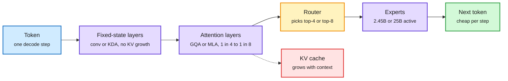

# LFM2.5-24B-A2B and Ling-3.1-flash: two open hybrids that keep most layers off the KV cache

**Date:** 2026-10-14 · **Source:** Hugging Face model cards (LiquidAI, inclusionAI), HF blog, NVIDIA RTX Spark post · **Raw:** [labs 10-13 23:02](../../raw/labs/2026-10-13-230220-labs.md), [labs 10-14 22:00](../../raw/labs/2026-10-14-220018-labs.md), [HF blog RSS](../../raw/rss/2026-10-13-huggingface-blog-run-fast-private-agents-on-device-with-lfm2-5-24b-a2b.md)

## TL;DR

Two open-weight releases in one window apply the same recipe at opposite ends of the size range. **LiquidAI's LFM2.5-24B-A2B** (24B total, 2.45B active) is an on-device agent model: 40 layers, of which 30 are double-gated short-convolution blocks and only 10 are GQA attention (grouped-query attention, where several query heads share one key/value head to shrink the cache), with 64 experts per MoE block and top-4 routing, trained on 36T tokens, 128K context. Liquid claims 184 tok/s on an Apple M5 Max, up to 21K output tok/s on one B300, up to 1.7x faster than comparable MoEs on-device, and 48.09 vs 38.19 on LiveClaw against Qwen3.6-35B-A3B. **inclusionAI's Ling-3.1-flash** (560B total, 25B active, MIT, FP8) uses 63 KDA linear-attention layers to 9 gated MLA layers (7:1), 512 routed experts with 8 active plus 1 shared, and a 1M-token window, with day-0 SGLang support including MTP speculative decoding. In both, three quarters or more of the layers carry a fixed-size state instead of a KV cache that grows with every token.

Only a few layers pay the per-token cache bill

Both models stack cheap fixed-state layers and keep a thin band of real attention for recall.

Blue is the input token, purple is computation, amber is the expert router, red is the memory that still grows, green is the output.

## Key points

- **LFM2.5-24B-A2B ships the full serving matrix on day one:** native, FP8 (block-wise weights, dynamic activations) for vLLM/SGLang, GGUF, ONNX, MLX 4/5/6/8-bit, and a DSpark speculative-decoding draft "coming soon". Liquid recommends pairing it with retrieval for knowledge-heavy tasks; it is built for tool calls, not recall.
- **Ling-3.1-flash** claims strong scores on Terminal-Bench 4.0, SWE-bench Pro, FrontierSWE and GDPVal-AA, and ships LingCode, a long-horizon harness built on the Pi agent with repeated context compaction.
- **Same week, same direction:** NVIDIA's Nemotron 3.5 Bolt (74B total, 9B active) targets RTX Spark laptops with 2-bit quantization-aware training to fit 24GB, out 10-15.

## How it relates to prior wiki pages

- **Confirms the hybrid-serving pattern** from [Priming (10-13)](../llms-foundation-models/2026-10-13-priming-hybrid-ssm-from-transformers.md), which turned a Transformer's local-attention layers into SSMs for under 0.5% of pretraining cost, and [ReplaySSM (10-13)](2026-10-13-replayssm-cache-inputs-not-state.md), which showed the state writes of such layers dominate decode at batch 256. Two production-grade releases now ship the 3:1 to 7:1 fixed-state ratio those papers assume.
- **Extends** the [Hybrid Mechanics 1.1 (10-09)](../llms-foundation-models/2026-10-09-hybrid-mechanics-rlt-cmm.md) finding that linear-attention hybrids gain most from long-context continual pretraining: Ling-3.1-flash's 1M window with 9 MLA layers is that bet at 560B.
- **Connects to the disaggregation argument** on X this window: KDA-style layers do roughly 1 FLOP per byte, so a full GPU SM is wasted on them. Ling's 7:1 ratio makes that argument concrete.

## Open questions

- Neither card reports long-context retrieval (needle or RULER) at full window. The thin attention band is exactly where recall should break.
- Liquid's 1.7x on-device speedup is against "comparable MoEs", unnamed. An independent llama.cpp number on the same Mac would settle it.

## Related

[kv-cache.md](kv-cache.md) · [attention mechanisms](../llms-foundation-models/attention-mechanisms.md) · [quantization.md](quantization.md)
