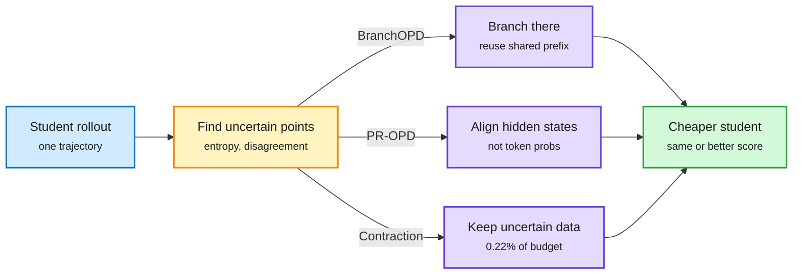

# Three ways to get more from each distillation token: BranchOPD, PR-OPD, Progressive Contraction

**Date:** 2026-10-14 · **Source:** HuggingFace Daily Papers 10-13 · **Raw:** [BranchOPD](../../raw/huggingface/2026-10-13-branching-on-policy-distillation.md), [PR-OPD](../../raw/huggingface/2026-10-13-pr-opd-privileged-representation-on-policy-self-distillation.md), [Learning More by Training Less](../../raw/huggingface/2026-10-13-learning-more-by-training-less-uncertainty-guided-progressiv.md)

## TL;DR

Three papers on the same HF list attack the cost of distilling reasoning and agent behavior from three different angles.

- **[BranchOPD](https://arxiv.org/abs/2610.13481)** (on-policy distillation, OPD: the student generates, the teacher grades each token). One student rollout shows only one continuation at each decision. BranchOPD finds the decision points where the student is uncertain and disagrees with the teacher, resamples alternative continuations from the shared prefix, and supervises both trunk and branches. Reusing prefixes cuts student-generated tokens by about 19% on ALFWorld and 31% on WebShop versus seven independent rollouts, and it beats both vanilla OPD and 7-rollout OPD: +18.55 points avg@16 on math and +13.8 points ALFWorld success over vanilla OPD. A side fix, protocol-boundary repair, directly supervises end-of-answer and protocol tokens, because a teacher reading a student's runaway prefix tends to continue the runaway.
- **[PR-OPD](https://arxiv.org/abs/2609.36642)** (privileged self-distillation: the same policy, given a "skill" hint, teaches its hint-free self). It finds token probabilities are the wrong channel: a skill in context lifts WebShop success from 42.2% to 56.2% yet changes the probabilities of fewer than a quarter of sampled tokens, while it changes the hidden states of over 80% of tokens in a way linear probes can trace to the skill. So PR-OPD aligns projected hidden states at every layer to the skill-conditioned pass, after a GRPO warm start. Up to +4.7 points ALFWorld and +14.0 points WebShop over GRPO, with no separate teacher and no inference overhead.
- **[Uncertainty-guided progressive contraction](https://arxiv.org/abs/2610.12933)** (SFT data selection). Build Monte Carlo reasoning trees around intermediate steps of teacher chains of thought to measure where the reasoning is uncertain, shrink the corpus to the uncertain parts, then route training online toward what the student has not yet learned. It reports matching or beating full-data SFT with as little as 0.22% of the optimization budget (over 450x less training exposure), including black-box teachers and weak-to-strong transfer.

Spend supervision where the student is unsure

All three papers locate the few decisions that carry signal and stop paying for the rest.

Blue is the student's output, amber is the uncertainty filter, purple is each paper's intervention, green is the result.

## How it relates to prior wiki pages

- **Pattern now at n=4 for "selective supervision beats uniform supervision" in two days:** [Semi-OPD (10-13)](2026-10-13-semi-opd-and-when-on-policy-distillation-fails.md) showed fresh on-policy rollouts only pay when teacher and student already agree (one cached rollout set beat OPD in 14 of 17 pairs, 11.4x faster). Today's three papers each find a different place to cut: branch points, the supervision channel, and the data itself.
- **PR-OPD contradicts the token-level OPD frame** that the [10-08 reliability cluster](2026-10-08-opd-supervision-reliability-cluster.md) refined, and echoes OPRD's hidden-state matching noted earlier on the [knowledge-distillation page](knowledge-distillation.md). If a skill's effect is mostly invisible in token probabilities, every logit-only distillation loss is under-reading the teacher.
- **Contraction extends the 04-16 TIP result** (most teacher-generated tokens carry no signal) from tokens to whole trajectories, and to a 450x scale of saving.

## Gaps

- BranchOPD and PR-OPD are tested on ALFWorld/WebShop and math; neither on SWE or long-horizon terminal tasks.
- Contraction's MC trees cost teacher compute that the 0.22% figure excludes. The headline counts student optimization only.

## Related

[knowledge-distillation.md](knowledge-distillation.md) · [RL for LLMs](../llms-foundation-models/rl-for-llms.md)
