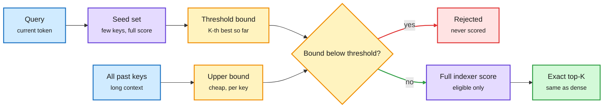

# DoSA: certify which keys can never win, and skip scoring them

**Date:** 2026-10-15 · **Source:** HuggingFace Daily Papers (14 Oct, 67 upvotes) · **Paper:** [arXiv 2610.13990](https://arxiv.org/abs/2610.13990)
**Raw:** `raw/huggingface/2026-10-14-dosa-dots-sparse-attention.md`

## TL;DR

Learned sparse attention (DeepSeek's DSA-style designs, where a small "indexer" scores every past key and the main attention only visits the top-K) has a hidden cost: the attention step is sparse, but the indexer still scores every key with every indexer head. At long context that full scan dominates prefill. **DoSA (Dots Sparse Attention)** makes the indexer itself conditional while keeping the exact same top-K. The insight: to reject a key you only need proof that it cannot beat the K-th best score, not its full score. A seed set gives a lower bound on the winning threshold. Non-negative head projections plus joint residual bounds give an upper bound on each candidate's positive contribution; activation-informed aggregation bounds what negative heads can subtract. Any key whose upper bound falls below the threshold is certified out without full scoring. Exact-score filtering then trims writeback and selection work. The GPU indexer runs up to **2.74x faster than SGLang's** and **1.69x faster than LiteTopK**; end-to-end time-to-first-token is up to **1.94x** better on GLM-5.2 and **1.50x** on DeepSeek-V3.2. It is **lossless**: the selected tokens are identical.

Most keys are rejected by a bound, not by a score

Only keys whose upper bound could still beat the threshold get fully scored.

Blue is input, purple is real scoring work, amber is the cheap bound and the gate, red is skipped work, green is the unchanged result.

## Key points

- **Where the time goes.** In indexer-based sparse attention, the indexer is cheap per key but touches all of them. At 100K+ context it becomes the prefill bottleneck even though the attention it feeds is sparse.
- **Why it is exact.** Rejection only happens when an upper bound on a key's score is below a lower bound on the top-K threshold. No approximation, so no accuracy trade.
- **What governs the speedup.** The paper analyzes how query-key geometry and the margin between winners and losers set how many keys get certified out. Large margins mean big savings; near-ties mean most keys still need full scoring.
- **Results.** Indexer up to 2.74x over SGLang, 1.69x over LiteTopK across English, Chinese and code workloads. TTFT up to 1.94x (GLM-5.2) and 1.50x (DeepSeek-V3.2).

## Relation to prior wiki pages

- **Extends** [FlashMemory-DS-V4 (06-09)](2026-06-09-flashmemory-ds-v4-lookahead-sparse-attention.md), which trained a separate neural indexer to predict which KV chunks future queries need and keep only those resident (13.5% footprint). FlashMemory shrinks what is stored; DoSA shrinks what the existing indexer has to read. They compose.
- **Same family as** [SAS (09-14)](2026-09-14-sas-attention-sparsification-end-to-end.md) and [CompactAttention (05-19)](2026-05-19-compactattention-chunked-prefill-block-union-kv-selection.md): the selection step, not the attention step, is now the cost center of sparse attention.
- **Branch-and-bound pattern:** this is classic pruning-by-bound applied to a GPU kernel. It mirrors the "certify, then compute" structure of exact top-K retrieval in vector search.

## Research angle

- The bounds need non-negative head projections. Is that a free reparameterization of existing indexers, or does it require retraining? The abstract implies it is built into the method; worth checking whether it applies to an off-the-shelf DeepSeek-V3.2 indexer as is (the end-to-end numbers suggest yes).
- Decode is a different regime: one query per step, small K-th-best margins early in generation. The reported wins are TTFT. The decode-time speedup is the missing number.

Concept pages: [KV cache](kv-cache.md) · [GPU kernels](../hardware/gpu-kernels.md)
