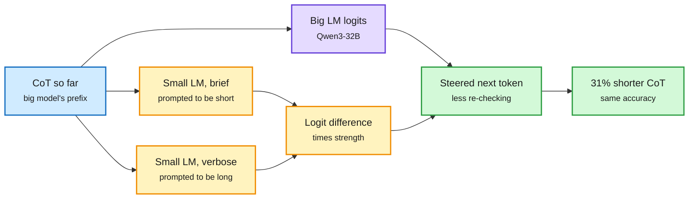

# DoubtLess: a small model talks a big reasoner out of re-checking

**Date:** 2026-10-15 · **Source:** HuggingFace Daily Papers (14 Oct) · **Paper:** [arXiv 2610.18862](https://arxiv.org/abs/2610.18862) · [Code](https://github.com/leoluolol/DoubtLess)
**Raw:** `raw/huggingface/2026-10-14-doubtless-training-free-contrastive-decoding-for-efficient-r.md`

## TL;DR

Reasoning models over-spend tokens, mostly by re-checking answers they already have. Existing fixes either need training per model, add a fixed steering vector, or use blunt heuristics (stop early, ban the word "wait") that cost accuracy. **DoubtLess** is training-free. A much smaller reasoning model reads the big model's chain of thought (CoT) so far twice: once prompted to be brief, once prompted to be verbose. The difference between those two logit vectors, times a strength, is added to the big model's logits at every CoT step. The small model supplies a "brevity direction" that adapts to the current context. On seven math, science and coding benchmarks it **shortens Qwen3-32B's CoT by 31% at unchanged accuracy**, beating five inference-time baselines; it cuts **thinking tokens per turn by 20%** in a self-debugging coding agent; it transfers to two other model families; and it stacks on top of models already trained for brevity. Most savings come **after the correct answer first appears** in the CoT.

The brevity signal is a difference of two small-model readings

Same prefix, two prompts; the gap between them steers the big model at every step.

Blue is the shared prefix, amber is the small model's steering signal, purple is the big model, green is the output.

## Key points

- **Contrastive decoding, repurposed.** Classic contrastive decoding subtracts a weak model's logits to boost what the strong model knows that the weak one does not. DoubtLess contrasts the *same* small model under two prompts, isolating a style direction (brief minus verbose) rather than a knowledge direction.
- **Cost.** Two extra small-model forward passes per CoT token. With a small model several times smaller than the target, the 31% shorter CoT is a net saving; the paper does not report wall-clock net of the overhead in the abstract.
- **Where the tokens go.** Savings concentrate after the answer first appears, i.e. the method mostly cuts verification loops. That matches the [10-14 "Thinking Inertia" finding](../daily-digest/2026-10/2026-10-14.md) that models keep thinking when told not to.

## Relation to prior wiki pages

- **Same mechanism family as** [LoopCD (10-03)](../llms-foundation-models/2026-10-03-loopcd-looped-contrastive-decoding.md), which contrasts a looped model's own loop depths. Two contrastive-decoding steering papers in two weeks; both are training-free.
- **Complements** the [10-06 shorter-CoT faithfulness result](../daily-digest/2026-10/2026-10-06.md): length pressure lowered faithfulness mostly through inconsistency, but monitorability survived. DoubtLess cuts length at decode time, not by training, so it is a cleaner test of whether shorter traces stay monitorable.
- **Contrasts with** [HyperThink (10-14)](../daily-digest/2026-10/2026-10-14.md), which replaces the trace with a query-specific weight update. HyperThink removes the trace; DoubtLess trims it.

## Research angle

- Does the brevity direction also shorten traces that matter for safety monitoring? The method suppresses re-checking, which is exactly where a model might reveal doubt.
- The steering model could be a decision model reading "is the answer already in the CoT?" A stop signal is cheaper than per-token steering.

Concept page: [Test-time compute allocation](test-time-compute-allocation.md)
