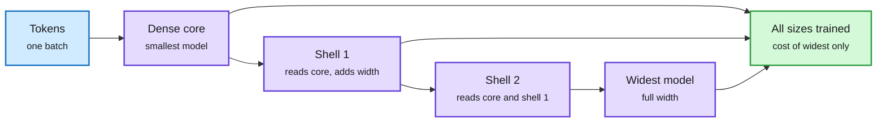

# Efficiency shorts, 2026-10-15: elastic pretraining, tacit reasoning, small-batch repeats, and practitioner speedups

**Date:** 2026-10-15 · **Sources:** HuggingFace Daily Papers (14 Oct), Kurate cs.AI + cs.LG weekly top-20, lab watcher (StepFun HF repo), X Following feed, YouTube (GPU MODE, Hugging Face)
**Raw:** `raw/huggingface/2026-10-14-*.md`, `raw/kurate/2026-10-15-cs-*.md`, `raw/labs/2026-10-15-143721-labs.md`, `raw/youtube/2026-10-15.json`, X feed captures (private)

## ShellElastic: one pretraining run, many model sizes (cross-source confirmed, HF + Kurate)

[arXiv 2610.15124](https://arxiv.org/abs/2610.15124) · Kurate cs.LG #5 (ai_rating 6.5) and on HF 14 Oct.

Elastic models train several nested sub-networks inside one weight-shared supernet so one run serves many inference budgets. Prior recipes (MatFormer and fully elastic designs) had three problems: per-step workloads that vary and break distributed scaling, hyperparameters that do not transfer across sizes, and no guarantee every sub-network learns at full speed. **ShellElastic** organizes hidden dimensions into a dense core plus successive shells so every hidden matrix is block lower-triangular. One full-width forward pass then contains every sub-network's exact hidden states as prefixes. Joint training keeps a fixed graph and costs about the same per step as training the widest model alone. **μE** extends maximal-update parameterization (μP, the scaling rule that lets hyperparameters tuned on a small model transfer to a large one) to elastic models, provably keeping all sub-networks maximally updated at once. One run beats MatFormer and fully elastic baselines at matched parameters and approaches separately trained models that together take several times the steps.

Every smaller model is a prefix of the biggest one

Block lower-triangular weights mean one wide forward pass computes all sizes exactly.

Blue is input, purple is the nested model widths, green is the payoff.

**Why it matters for serving:** a family of exact nested models is a native substrate for routing by budget. A router can pick width per request without loading a second checkpoint. It is the training-side counterpart of the 10-13 "compute dials inside one checkpoint" entry in [test-time compute allocation](test-time-compute-allocation.md).

## TacitVLA: reasoning helps even when the action never reads it (cross-source confirmed, HF + Kurate)

[arXiv 2610.17540](https://arxiv.org/abs/2610.17540) · Kurate cs.AI #7 and HF 14 Oct.

Robot and driving policies that write reasoning before acting are better but slow, because the action waits for decoding. TacitVLA's claim: the benefit comes from reasoning *supervision* shaping the backbone, not from the action attending to the text. Its action expert never attends to the reasoning generated for the current call; on long tasks the reasoning is written during execution as episodic memory. On RoboMME, RMBench, LIBERO and PhysicalAI-AV it matches explicit reasoning at **up to 3.4x lower latency** and beats no-reasoning training by **up to +17.1%** success. New bests: RoboMME Counting 82.7% (vs 66.8%), RMBench 77.5% (vs 56.5%). The same idea as [HyperThink (10-14)](../daily-digest/2026-10/2026-10-14.md) and Tacit's self-distilled decision models ([10-11](../ai-routing/2026-10-11-decision-model-category-decision1-anyjev-vega.md)): train with reasoning, serve without waiting for it.

## Repeated-data pretraining: smaller batches, fewer GPUs, lower loss

[arXiv 2610.15965](https://arxiv.org/abs/2610.15965). When unique data is finite and you must repeat epochs, validation loss is U-shaped in batch size and favors smaller batches than usual (gradient noise acts as regularization). Per-epoch document repacking, weight tying and positive embedding weight decay help. Treating GPUs and time as separate budgets: tight deadlines favor larger batches, but **even under a fixed time budget, a smaller batch on fewer GPUs can beat a larger batch on more GPUs**, which cuts against "max out data parallelism to hit the deadline." A GPU-allocation result for the data-constrained regime.

## RL-side optimizers and credit

- **Ares** ([2610.16533](https://arxiv.org/abs/2610.16533)): in RLVR (reinforcement learning with verifiable rewards), gradient energy concentrates into a shrinking low-rank subspace, absent under SFT and largely gone with random rewards. Ares estimates the effective rank from the spectrum and confines updates to it. Beats standard optimizers across scales. A low-rank structure result that also hints RLVR updates are compressible.
- **Proximal KL** ([2610.18738](https://arxiv.org/abs/2610.18738)): token-wise importance sampling for off-policy RLVR made unbiased via bounded future KL credit instead of PPO clipping. Up to +2.58% over GRPO on Qwen3-1.7B/4B under rollout staleness; avoids PG/CISPO collapses. Relevant to async rollout systems where staleness is a throughput knob.
- **DeltaTTG** ([2610.17666](https://arxiv.org/abs/2610.17666)): a frozen "tokens-to-go" meter redistributes outcome advantages across agent steps. +5.7 / +7.2 over GRPO (Qwen3-4B, Llama-3.1-8B) at near-GRPO GPU-hours.

## Long-video memory and diffusion compression

- **FramePack-U** ([2610.16118](https://arxiv.org/abs/2610.16118)): training-free, packs arbitrarily long video into a fixed token budget by prompt relevance plus diversity at mixed resolution. Constant memory; +12.9 / +10.6 / +9.7 on LongVideoBench / MLVU / Video-MME for Qwen3.5-35B-A3B at 128 frames.
- **APEX** ([2610.12843](https://arxiv.org/abs/2610.12843)): hierarchical latent channels denoised asynchronously; beats a 256-token model at matched compute under 64-128x compression.

## Practitioner and release notes

- **StepFun Step-5-Preview-NVFP4** ([HF](https://huggingface.co/stepfun-ai/Step-5-Preview-NVFP4)): the 600B-total / 27B-active MoE (1M context) now has an NVFP4 checkpoint next to FP8 and BF16. The card's FP8 recipe serves it on **one 4-GPU B300 node** or one 8-GPU H200 node with TP/TEP/DEP, prefix caching and 3-token MTP speculative decoding. Open weights; the 10-10 digest covered the API launch.
- **GSQ-RCO** (GPU MODE talk, ISTA DASLab): Gumbel-Softmax quantization plus Riemannian precision allocation under a fixed size budget, shipped as non-uniform GGUF models ([video](https://youtube.com/watch?v=ECZPAzT6VgQ)).
- **Databricks Qwen3.8-27B fine-tune**: at 98% reported GPU utilization the run still went from 7h44m to 1h17m (~6x) by using fused kernels matched to the linear-attention layers and repacking samples to kill padding. "Utilization" was measuring busy, not useful (via X feed).
- **HobbyLM**: a two-person team trained a 1B sparse MoE from scratch on 4 H200s in 76 hours (~300 GPU-hours). Social claim, no paper.
- **RTX 5090 vs M5 Ultra** (Hugging Face video): Qwen3.8-27B decode is bandwidth over model size; 32 GB VRAM vs 256 GB unified memory decides what fits ([video](https://youtube.com/watch?v=qaP4pymNrEc)).

## Relation to prior wiki pages

- ShellElastic and TacitVLA are the two non-routing cross-source confirmations this week; both are "train once, pay less at serve time" results.
- Databricks' 6x at "98% utilization" is the same lesson as the [10-14 fused MoE on Hopper page](../hardware/2026-10-14-fused-moe-hopper-and-batch-invariance.md): occupancy metrics hide wasted work.

Concept pages: [Quantization](quantization.md) · [Test-time compute allocation](test-time-compute-allocation.md) · [GPU kernels](../hardware/gpu-kernels.md)
