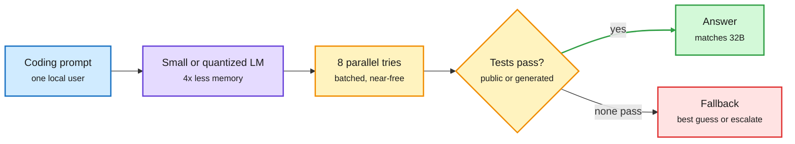

# Fewer Bits, More Tries: a compressed model plus verified retries can match a bigger one

**Date:** 2026-10-15 · **Source:** Kurate cs.AI weekly top-20 (#9, ai_rating 6.5) · not on HuggingFace · **Paper:** [arXiv 2610.15372](https://arxiv.org/abs/2610.15372) (Galanti, Susskind, Malach; Apple)
**Raw:** `raw/kurate/2026-10-15-cs-ai.md`

## TL;DR

Local inference for one user leaves the GPU mostly idle: decode is memory-bound, so generating eight candidates in parallel costs little more wall-clock than generating one. The paper asks whether that spare compute can buy back the accuracy lost to a smaller or more compressed model. On four code-generation benchmarks, it can: generate N candidates in parallel, check them against public or model-generated tests, return the first that passes. **Qwen 7B with eight parallel attempts essentially matches Qwen 32B on MBPP+ and beats it on the other three benchmarks, with about 4x less model memory, up to 6x faster, and less energy** on an NVIDIA GPU. The trade holds across model sizes, compression levels and hardware, with the exact gain set by the hardware profile and the task.

Spend idle parallel compute instead of memory

The verifier turns cheap extra tries into accuracy; memory, not FLOPs, is the scarce resource.

Blue is the request, purple is the small model, amber is the retry loop and verifier, green is the accepted answer, red is the no-pass case.

## Key points

- **Why it works.** Single-stream decode reads all weights per token and leaves compute idle. Batching N candidates reuses each weight read N times, so latency grows sublinearly with N. A smaller model also reads fewer bytes per token, which is where the up-to-6x speed comes from.
- **The condition.** The trade only works when a correct solution is reachable within a modest retry budget and a verifier exists. Code with tests is the best case.
- **What it measures.** Accuracy, memory, latency and energy together, on real GPUs, across compression levels. That four-way reporting is rarer than it should be.

## Relation to prior wiki pages

- **Reframes** [quantization](quantization.md): the usual question is how many bits a model can lose before accuracy drops. This paper says the accuracy you lose to bits can be bought back with verified test-time compute, so the right metric is accuracy at a fixed memory budget with retries allowed.
- **Confirms from the deployment side** the [test-time compute allocation](test-time-compute-allocation.md) thread: CLEAR (rationing compute across a batch with one shadow price) and the 10-12/10-13 entries argue compute should go where it changes the answer. Here the verifier is what tells you.
- **Practitioner echo:** the Medium piece "Is running a local LLM still worth it after Haiku 5.5?" (Gmail, 10-15) argues cheap cloud models now match Qwen 3.8 27B locally. This paper is the counterargument for verifiable tasks: run the 7B locally, retry eight times, skip the 27B.
- **Contrasts with** routing: a router sends hard prompts up to a bigger model; verified retry keeps them on the small model and spends more tries. On code with tests, retry is cheaper and needs no router.

## Research angle

- Where is the crossover between "retry the small model" and "route to the big one"? It depends on pass@k growth of the small model versus the price of a remote call. The paper gives the local side; the routing page has the remote side. Nobody has put them on one curve.
- Model-generated tests can be wrong. How much of the gain survives when the verifier is the same compressed model?

Concept pages: [Quantization](quantization.md) · [Test-time compute allocation](test-time-compute-allocation.md)
