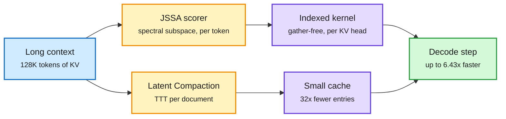

# JSSA and Latent Compaction: two training-free routes to a smaller long-context cache read

**Date:** 2026-10-16 · **Source:** HuggingFace Daily Papers (15 Oct) · **Papers:** [JSSA, arXiv 2610.19026](https://arxiv.org/abs/2610.19026) · [Latent Compaction, arXiv 2610.20582](https://arxiv.org/abs/2610.20582) · [code](https://www.github.com/THUNLP/latent-compaction)
**Raw:** `raw/huggingface/2026-10-15-joint-subspace-sparse-attention-for-efficient-long-context-d.md`, `raw/huggingface/2026-10-15-latent-compaction-with-test-time-training.md`

## TL;DR

Long-context decoding is bound by how much KV cache each step reads. Two papers attack that read from opposite sides without retraining the model.

**Joint Subspace Sparse Attention (JSSA)** reads fewer tokens. It picks individual tokens (not pages or blocks) to attend to, scoring them in a small shared query-key subspace. That subspace has a closed-form spectral solution, so there is no training. The second half is a kernel: a gather-free indexed-attention kernel that handles different token picks per KV head under the standard GQA layout (grouped-query attention, where several query heads share one KV head), so scattered picks do not cost the speedup back. It works on GQA, hybrid sliding-window/global models and MLA (DeepSeek's compressed latent attention). On a B200 it reaches **up to 6.43x decoding throughput** over full KV at 128K, stays close to full-KV accuracy, matches model-native DSA (DeepSeek's trained sparse attention) on reasoning without training, and gets **96-99% of DSA's throughput at 700B scale**.

**Latent Compaction** stores fewer entries. For each document, it learns a small replacement cache by test-time training. Entries are initialized by reconstruction importance, teacher attention and key diversity, then fitted to match the full cache's attention outputs and normalizers, then optimized end to end by distilling from the full-cache model. Model weights stay frozen and only generic prompts about the document are used, never the downstream questions. On RULER at **32x compression it scores 96.7% vs 40.0% for KVZip+**. It transfers across Qwen3 and MiniCPM5.

Read fewer tokens, or store fewer entries

JSSA cuts the read per step; Latent Compaction shrinks the cache once per document.

Blue is the full cache, amber is the selection or compaction step, purple is the cheaper artifact, green is the faster decode.

## Relation to prior wiki pages

- **DoSA (10-15)** made the *indexer* of trained sparse attention cheaper by proving which keys cannot win ([page](2026-10-15-dosa-dots-sparse-attention.md)). JSSA removes the need for a trained indexer at all. Together: DSA-style models get a cheaper indexer (DoSA), non-DSA models get a training-free one (JSSA).
- **The 10-15 KV cache entry asked for decode-time speedup numbers**, which DoSA lacked (it reported prefill/TTFT). JSSA reports decode throughput directly: 6.43x at 128K on B200. Partial answer to that open question.
- Latent Compaction sits in the same family as [parametric context internalization](parametric-context-internalization.md) and Cortex (same day, distils context into weights): treat context as something to optimize, not just store. It differs because the weights stay frozen and only the cache is trained.
- See [kv-cache](kv-cache.md), [attention-mechanisms](../llms-foundation-models/attention-mechanisms.md).

## Gaps

JSSA: B200 only, no H100 numbers; generation-length effects reported only against competing methods. Latent Compaction: per-document TTT cost is not amortized against query count in the abstract; it only pays off when one document is queried many times (RAG over a fixed corpus, agent memory).

## Research angle

The two compose. Compact a document once (32x fewer entries), then token-select within the compacted cache at decode. Nobody has measured whether compaction destroys the low-rank query-key structure JSSA's scorer relies on.
