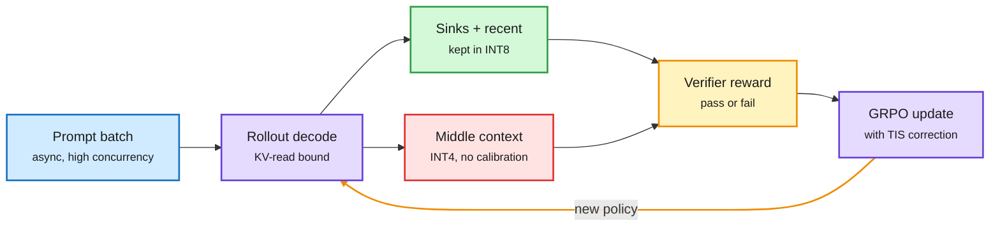

# KV4-RL: quantize the KV cache, not the weights, to speed up RL rollouts

**Date:** 2026-10-16 · **Source:** HuggingFace Daily Papers (15 Oct) · **Paper:** [arXiv 2610.14448](https://arxiv.org/abs/2610.14448)
**Raw:** `raw/huggingface/2026-10-15-kv4-rl-unlocking-faster-asynchronous-rollouts-for-rlvr-with.md`

## TL;DR

RLVR (reinforcement learning with verifiable rewards, where a checker scores each answer) spends most of its wall-clock time generating rollouts. Asynchronous rollout keeps the GPUs busy during long-tail generations, but sustained high concurrency means each decode step reads far more KV cache (the stored keys and values of every past token). The paper measures this "KV concentration" and finds that, at matched workload, **quantizing the KV cache speeds rollouts much more than weight-only or weight-plus-activation quantization**. Naive INT4 KV hurts learning, even with truncated importance sampling (TIS, the standard fix for sampler/trainer mismatch). **KV4-RL** keeps INT4 for most of the cache but protects a bounded set of positions in INT8: the attention sinks (the first few tokens every head attends to) and the recent window. On 400 iterations of Qwen3-8B-Base GRPO, it gets **1.80x cumulative rollout speedup**, **1.27x full-iteration speedup**, and **1.97x rollout speedup over the last 50 iterations**, with six-benchmark accuracy within **0.5 points** of BF16 rollouts on both 4B and 8B.

Most of the cache goes to INT4; only the fragile slice stays at INT8

The protected positions are few and fixed, so the speedup survives.

Blue is input, purple is compute, green is the protected cache, red is the aggressively compressed cache, amber is the reward loop.

## Key findings

- In async RLVR the bottleneck shifts from weights to KV reads, so KV quantization wins over weight quantization at matched workload.
- INT4 KV alone degrades learning: the sampler's distribution drifts from the trainer's, and TIS does not fully correct it.
- Protecting sinks plus recent tokens in INT8 removes most of the mismatch. 1.80x rollout, 1.27x end-to-end, within 0.5 points accuracy.
- Calibration-free: no per-model scale fitting.

## Relation to prior wiki pages

- **Confirms the "find the fragile part and protect only it" pattern** recorded on the [KV cache page](kv-cache.md) on 10-13: QuantMLA found the RoPE path of MLA's latent cache is error-sensitive and kept it at higher precision; ReplaySSM found the SSM state's write traffic was the real cost. KV4-RL finds the sink and recent positions are the fragile slice. Three papers in four days now protect a small, structurally identified subset and compress the rest.
- **Extends** the vLLM bitwise-consistent RL work (10-14, sampler and trainer produce identical outputs to kill off-policy drift). KV4-RL deliberately introduces sampler drift for speed and then bounds it. The two are in tension: one buys correctness, the other buys speed with a measured mismatch.
- **Extends** [ResidualQuant (10-14)](2026-10-14-efficiency-shorts.md), which compressed per-loop KV in looped models to a 4-bit anchor plus 2-bit residuals.
- See also [quantization](quantization.md), [RL for LLMs](../llms-foundation-models/rl-for-llms.md).

## Gaps

Only Qwen3 4B/8B base models, 400 iterations, math-style verifiable rewards. No long-horizon agent RL where contexts reach 100K+ and the KV share is even larger. No comparison with FP8 KV, which many serving stacks already default to.

## Research angle

Is the INT8-protected set learnable per head rather than fixed (sinks + recent)? Attention-sink position is known to vary by head; a per-head protected budget could push more of the cache to INT4 or INT2.
