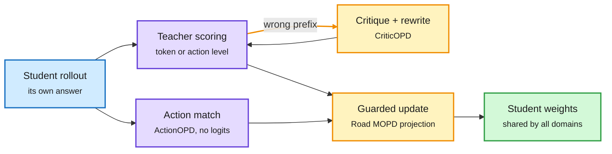

# On-policy distillation: guard the shared weights, repair the teacher, distil decisions

**Date:** 2026-10-16 · **Source:** HuggingFace Daily Papers (15 Oct; #3, #5, #6 and #9 by upvotes)
**Papers:** [Road MOPD, arXiv 2610.13521](https://arxiv.org/abs/2610.13521) · [CriticOPD, arXiv 2610.20572](https://arxiv.org/abs/2610.20572) · [ActionOPD, arXiv 2610.19820](https://arxiv.org/abs/2610.19820) · [Self-distillation reality check, arXiv 2610.19789](https://arxiv.org/abs/2610.19789)

## TL;DR

On-policy distillation (OPD: the student generates its own answers and the teacher scores every token of them) had four papers in the HF top ten. Each fixes one broken assumption.

- **Road MOPD (238 upvotes, #3 of the day).** Multi-teacher OPD routes math data to a math teacher, code to a code teacher, and so on. But all updates land on the same student weights, so teachers with different styles fight. Road MOPD adds the *non-routed* teachers as critics on the same trajectories. Tokens all teachers agree on get stronger updates; conflicting ones are damped. A gradient projection blocks updates that would hurt other domains. **+5 points in the disadvantaged domain under high conflict.**
- **CriticOPD.** OPD assumes the teacher can reach a correct answer from any prefix the student writes ("recoverability"). On wrong rollouts that fails: the teacher follows the student's error even though it recognizes it. Fix: the teacher writes a critique, the student rewrites after the error, the teacher scores with the critique as privileged context, and the student trains on the revision without it. Largest gains on competition math.
- **ActionOPD.** For agents, distil *decisions*, not tokens. At student-visited states, sample actions from student and a black-box teacher, reward the student for semantic agreement. No teacher logits, no shared tokenizer. **+3.3 to +6.9 points** on four OOD tool-use benchmarks for Qwen3-4B/8B; competitive with token OPD on τ²-bench.
- **Reality check (132 runs, 12,124 H800 GPU-hours).** Ten self-distillation methods for agent RL against plain GRPO on ALFWorld, ScienceWorld, Search-QA, WebShop at three sizes. **No method beats GRPO consistently**; strong final scores hide unstable training; more training cost does not buy more performance.

Four fixes to one loop

Each paper patches a different link between the student rollout and the weight update.

Blue is the student's rollout, purple is the supervision signal, amber is the repair or guard step, green is the shared weights.

## Relation to prior wiki pages

- **The OPD thread on the [knowledge distillation page](knowledge-distillation.md) now runs nine days straight** (10-07 to 10-16). The 10-08 cluster gated the teacher, 10-09 called the teacher an implicit reward, 10-10 showed OPD organizes skills rather than adding facts, 10-13 Semi-OPD said check alignment before paying for rollouts, 10-14 BranchOPD supervised only uncertain tokens.
- **CriticOPD gives the Gains-and-Collapse finding (10-09) a repair.** That paper said OPD collapses when the teacher's implicit reward misaligns; CriticOPD names one cause (non-recoverable prefixes) and fixes it with a critique.
- **ActionOPD answers the cross-tokenizer question from a new side.** The 10-08 top paper found cross-tokenizer OPD needs only strict 1:1 alignments. ActionOPD skips tokens entirely, so the tokenizer question disappears for agents.
- **The reality check is the counterweight.** It repeats the Vals AI finding (10-12, teams add little over a solo agent at max effort): a crowded method space where the simple baseline is hard to beat once compute is matched.

## Gaps

Road MOPD and CriticOPD: math/code domains, Qwen3 students only. ActionOPD's "semantic agreement" judge is itself a model whose errors are not analyzed.
