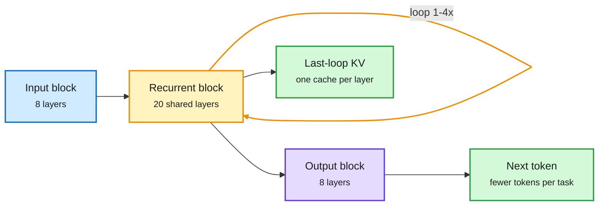

# NVIDIA Dory 1.0 (looped 4B) and Tencent DSpine (parallel drafter)

**TL;DR.** Two open releases from the lab watcher put recent efficiency research into shipped checkpoints. **NVIDIA Nemotron-Labs Dory1.0-4B** is a looped (latent-recurrent) model: 8 input layers, a 20-layer shared recurrent block applied 1, 2 or 4 times, and 8 output layers, with input re-injected each loop. One checkpoint serves several compute budgets by changing the loop count. It supports last-loop KV caching (one cache per recurrent attention layer, so no KV overhead vs a non-looped model at any loop count), was pre-trained natively in NVFP4 (4-bit float) before continuing in BF16, and ships in BF16, MXFP8, NVFP4 and GGUF Q5_K_M with 256K context. **Tencent DSpine** is a parallel drafter for speculative decoding: every position is drafted in parallel, but at each draft layer each position gets its predecessor's predicted feature, so the causal chain unfolds through depth. On Qwen3-8B it beats DSpark and DFlash2 on every benchmark in average acceptance length (7.83 vs 7.55 for DFlash2 at T=0; 6.98 vs 6.53 at T=1).

One set of weights, three compute budgets

Only the middle block repeats, and only its last pass is cached.

Blue is input, amber the loop, purple the output block, green what you save.

## Key numbers

**Dory1.0-4B (1 / 2 / 4 loops)** vs Qwen3.5-4B, Qwen3.5-9B, Gemma 4 26B-A4B, Qwen3.6-35B-A3B:
- SWE-bench Verified: 50.3 / 59.5 / 61.8 vs 54.7, 61.0, 57.4, 73.4.
- Terminal-Bench 2.1: 12.5 / 18.1 / 22.2 vs 15, 24, 35, 43.
- SciCode: 27.3 / 34.9 / 35.1 vs 25.8, 28.2, 40.3, 37.2.
- Read: 4 loops lifts a 4B to roughly 9B-dense level on SWE-bench and SciCode, but agentic terminal work still lags. Gains flatten from 2 to 4 loops.
- License: OpenMDW-1.1. [Card](https://huggingface.co/nvidia/NVIDIA-Nemotron-Labs-Dory1.0-4B-NVFP4).

**DSpine** ([card](https://huggingface.co/tencent/Qwen3-8B-DSpine-b16), arXiv [2609.36173](https://arxiv.org/abs/2609.36173)): all drafters retrained on the same data; DSpine leads on GSM8K (10.55), MATH-500 (10.30), HumanEval (8.27) and MT-Bench (5.63) at T=0. Apache-2.0, inference code released.

## Relation to prior wiki pages

- **Research-to-product in days.** ELR (10-13) proposed keeping only the last loop's KV in looped models; ResidualQuant (10-14) showed per-loop caches are nearly redundant. Dory ships last-loop KV as a feature. LatentLoop (10-16, scaling looped MoE with asymmetric compute) and "Your Transformer Is Secretly Elastic" (10-16) were the research side of the same week. See [looped-transformers](../llms-foundation-models/looped-transformers.md).
- **NVFP4 pretraining at small scale.** Earlier wiki NVFP4 items were post-training quantized releases (Muse Spark Open's NVFP4 build, 10-16). Dory is pre-trained natively in NVFP4.
- **DSpine continues the parallel-drafter race** ([speculative-decoding](speculative-decoding.md)): DFlash2 shipped with Muse Spark Open on 10-16 at ~3 accepted tokens/step on MT-Bench at its serving config. DSpine's numbers here are at block 16 on Qwen3-8B, so not directly comparable. The 10-16 warning stands: acceptance on agentic long-context traces is the number that matters, and nobody reports it.

## Gaps

- Dory reports no latency per loop count; loops cost compute even if they cost no cache.
- DSpine reports acceptance length, not wall-clock speedup under batching.

Concept pages: [looped-transformers](../llms-foundation-models/looped-transformers.md), [speculative-decoding](speculative-decoding.md), [quantization](quantization.md).
