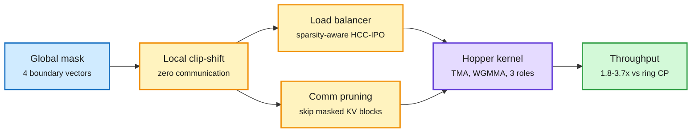

# FlashMask-3: mask-aware attention on Hopper, across context-parallel ranks

**TL;DR.** Long-context training mixes structured attention masks (document, prefix-LM, sliding window, block-sparse) with multi-node context parallelism (CP, splitting one sequence across GPUs), and the mask becomes the bottleneck. FlashMask stored masks in O(n) as four boundary vectors on the query axis but ran only on Ampere and one GPU. FlashMask-3 rebuilds it on FlashAttention-3's Hopper pipeline (TMA async copies, WGMMA tensor-core ops, warp specialization with three roles) and adds a distributed layer: each rank localizes its slice of the mask with zero communication (a clip-shift-max on the boundary vectors), a sparsity-aware load balancer (HCC-IPO), and compute-communication overlap that skips sending KV blocks the mask makes irrelevant. Single H100: +45-141% TFLOPs over FlashMask, +34-71% over FlexAttention, +2-44% over MagiAttention. At CP 4-32: 1.80-3.71x over Megatron-Core ring CP. End-to-end 118B-A14B MoE at 128K on 128 H100s: +7.3-11.0% throughput, attention fwd+bwd 24.5-44.9% faster.

The mask is cut locally and decides what gets sent

No rank asks another for its piece of the mask.

Blue is the mask, amber the per-rank decisions, purple the kernel, green the result.

## Relation to prior wiki pages

- **Same move as JSSA (10-16) and DoSA (10-15), applied to training.** Those skip keys that do not matter at decode; FlashMask-3 skips KV *communication* that the mask proves useless. Sparsity is now exploited at the network layer too.
- **Context-parallel prefill shows up twice today.** The remote-KV-tier paper ([2026-10-17](2026-10-17-remote-kv-tier-slower-than-gpu.md)) runs PCP8 at serving time; FlashMask-3 is the training-side CP story. Both found the bottleneck outside the attention math.
- [gpu-kernels](../hardware/gpu-kernels.md): first wiki kernel paper that is mask-aware *and* distributed on Hopper.

## Gaps

- Hopper only; no Blackwell (tcgen05) port reported.
- End-to-end gain (7-11%) is much smaller than the kernel gain, because attention is only part of a MoE step.

Concept pages: [gpu-kernels](../hardware/gpu-kernels.md), [attention-mechanisms](../llms-foundation-models/attention-mechanisms.md).
