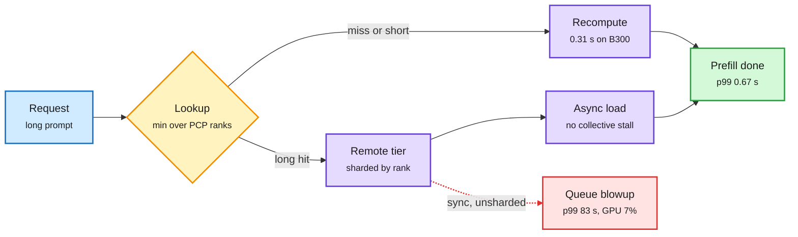

# When the KV Cache Is Slower Than the GPU: remote KV tiers for context-parallel prefill

**TL;DR.** A production study of a shared remote KV-cache tier (LMCache backed by a Valkey store) for GLM-5.3 (FP8 MoE with MLA, multi-head latent attention) on 8xB300 nodes running prefill context parallelism (PCP8, splitting one long prompt's prefill across 8 GPUs). Turning the remote tier on left median TTFT (time to first token) unchanged but pushed 16K-token p99 from 3.96 s to 17.3 s. A cache *hit* took 0.88 s; recomputing the prompt took 0.31 s. A two-term cost model explains it: a hit only pays if the tier delivers more than B* = sR (2.53 GB/s here, where s is KV bytes per token and R the GPU's prefill rate in tokens/s), and a fixed per-hit engine cost T0 ≈ 0.33 s means prompts under ~17K tokens can never beat recompute at any bandwidth. After sharding the MLA store by PCP rank, partitioning the remote tier one server per rank (GET bandwidth 6.3x to 10.76 GB/s), adding async loading and fixing three client bugs, p99 on a hit-heavy stream fell from 83.32 s to 0.67 s. Prefill throughput +14%, +34% with an upstream kernel fix. All changes upstreamed to LMCache.

A cache hit is only worth it above a bandwidth line and a length line

Below 17K tokens the fixed per-hit cost beats any network speed.

Blue is input, amber the hit-or-recompute decision, purple the work, green the fixed result, red the failure mode before the fixes.

## Key findings

- **The tier can make tail latency worse while the median looks fine.** Median TTFT unchanged, p99 up 4.4x.
- **Synchronous loading turns hits into a queue.** On a hit-heavy replay, p99 reached 83.32 s with GPUs 7% busy. The GPU waited on the network.
- **Break-even model.** Hit cost = T0 + bytes/B. Recompute cost = tokens/R. So the tier must beat B* = sR in bandwidth, and the prompt must be long enough to amortize T0. For GLM-5.3 on B300: B* = 2.53 GB/s, minimum useful hit ~17K tokens.
- **Fixes.** Shard the MLA KV store across PCP ranks (with a proof that the existing min-over-ranks lookup returns the longest cached prefix and a load protocol that cannot desynchronize collectives); one remote server instance per rank, no coordination; async loading; three client bug fixes that caused unbounded stalls.
- **Result.** 98.5% of prompt tokens served from the remote tier with p99 0.67 s. Prefill throughput +14% (+34% with a kernel fix).

## Relation to prior wiki pages

- **Contradicts the easy reading of storage-tier wins.** galahad-kv (10-09) reported NVMe reload 2.8-4.3x faster than recompute on an H100. On B300 with PCP8, recompute is fast enough that a remote hit lost 0.88 s vs 0.31 s. The faster the GPU, the higher B* climbs: storage-tier economics are hardware-relative, and Blackwell moves the line.
- **Gives the policy question a number.** The 10-09 kv-cache entry asked who decides what a session keeps. This paper says the first filter is mechanical: do not fetch hits under ~17K tokens on this hardware, regardless of policy.
- **Pairs with session-aware Dynamo (10-09)** and AMD's MoRI RDMA transport (10-11): both assume moving KV is cheap. This is the first wiki paper measuring when it is not.
- **Fits Ken Huang's inference book framing (10-16)** of "redundant prefill waste in tool-wait loops," but adds the counterpoint: re-prefill is sometimes the cheaper choice.

## Gaps

- One model (MLA compresses KV heavily, which *helps* the tier). For a GQA model with larger s, B* is higher and the tier is harder to justify.
- Valkey/LMCache only. No comparison with RDMA-native stores (Mooncake, MoRI).

Concept pages: [kv-cache](kv-cache.md), [memory-hierarchy](../hardware/memory-hierarchy.md).
