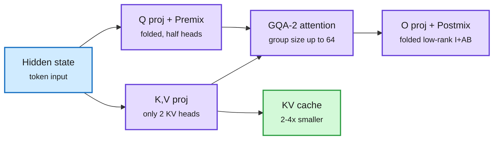

# Virtual Head Attention and PN-Mix: fewer KV heads, fewer key bits

**TL;DR.** Two papers shrink the KV cache from opposite ends. **Virtual Head Attention (VHA)** changes the architecture: it halves physical query heads, then recovers "virtual" head diversity with two linear mixes (Q Premix inside each KV group, low-rank Linear Postmix across heads). Both fold into the existing projections at inference, so the deployed model is a plain GQA-2 model (grouped-query attention with two KV heads) that reuses every GQA kernel. It beats GQA baselines at every scale while using 2-4x less KV cache. **PN-Mix** changes the numerics: for 2-bit-class key-cache quantization, it gives more bits to RoPE channel *pairs* whose query-key norm product is large, chosen once at prefill. At 2.26 average bits it matches or beats prior mixed-precision methods at 2.32-2.39 bits and degrades gracefully to 1.5 bits.

VHA trains rich heads and serves a plain two-head GQA model

The mixes are linear, so they disappear into the projections at inference.

Blue is input, purple the attention block as served, green the cache saving.

## Key findings

**VHA ([2610.17959](https://arxiv.org/abs/2610.17959)).**
- Frames an "impossible triangle": KV cache size, training/prefill FLOPs, quality. GQA has quality but a big cache; MLA compresses but loses quality; MFA compresses but costs compute.
- With two KV heads, group size reaches 64 in large models, which fills Tensor Cores during decode.
- 4K-context 50B-token pretraining, four scales: +0.05 to +0.81% over GQA at every scale, 4x less KV vs GQA-8 (dense), 2x vs GQA-4 (MoE), 7.9% fewer training/prefill FLOPs at 1.7B.
- Industrial 30B-A3B MoE, 500B tokens: beats MLA by +0.70 and GQA-4 by +2.60 on a 12-benchmark base suite. Matched 10B-A1B after long-context mid-training: RULER 84.4 vs 73.0 for GQA (8K-128K) with two vs four KV heads.

**PN-Mix ([2610.19605](https://arxiv.org/abs/2610.19605)).**
- Attention-logit perturbation analysis at RoPE pair level: quantization error in channel pairs with large query-key pair-norm products drives logit variation. Prior methods ranked channels by key statistics alone.
- Salient pairs chosen once at prefill, reused for all decode steps (no per-step overhead).
- 2.26 bits ≈ or > prior methods at 2.32-2.39 bits on reasoning, code and AIME; graceful to 1.5 bits, while baselines drop sharply below 2.25.

## Relation to prior wiki pages

- **Fifth "find the fragile slice" result.** The 10-16 kv-cache pattern (QuantMLA protects the RoPE path, ReplaySSM the state writes, KV4-RL the sinks and recent tokens) gains PN-Mix: protect the RoPE pairs where queries look hard. That is n=4 for quantization alone, all within five days.
- **PN-Mix vs QuantMLA (10-13).** Both say the rotary-position part of the key is where error is amplified. QuantMLA found it by path in MLA; PN-Mix by pair in standard RoPE models. Two architectures, same culprit.
- **VHA vs MLA.** The wiki has tracked MLA as the default cache compressor since DeepSeek. VHA claims to beat MLA on quality *and* keep GQA kernels. If it holds, MLA-specific kernel work (FlashMLA, QuantMLA) faces an alternative that needs no new kernels.

## Gaps

- VHA pretraining runs are 4K-8K context; the RULER gain is after long-context mid-training on one matched pair.
- PN-Mix assumes pair saliency found at prefill holds through long outputs; drift over 30K+ generated tokens is not shown.

Concept pages: [kv-cache](kv-cache.md), [quantization](quantization.md), [attention-mechanisms](../llms-foundation-models/attention-mechanisms.md).
