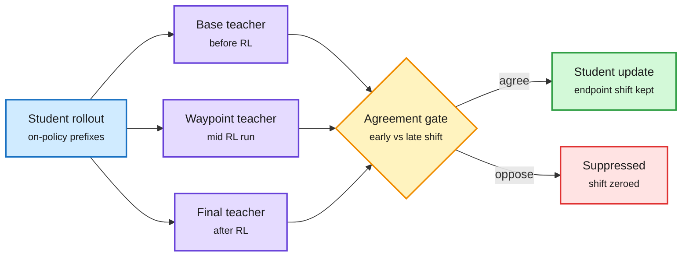

# Waypoint-OPD: distill only the RL shifts that stayed consistent

**TL;DR.** Policy-shift distillation teaches a student using the difference between an RL-trained teacher's log-probs *after* RL and *before* RL, scored on the student's own trajectories (on-policy distillation, OPD). The endpoint difference hides history: an action preference that rose early and fell late can look the same as one that rose steadily. Waypoint-OPD adds one intermediate checkpoint from the same RL run, compares the early shift (start to waypoint) with the late shift (waypoint to end) at each student-visited prefix, and gates the endpoint shift off where the two point in opposite directions. Cost: one extra frozen-teacher scoring pass. With RL-trained Qwen3-4B teachers and Qwen3-8B, Qwen3-14B and Qwen3-30B-A3B students on math and code, it has the best domain average in all six settings. Removing or shuffling the gates hurts math. Top HF paper of the day (660 upvotes).

Keep the shift only where early and late RL agree

One extra checkpoint turns a single difference into a direction check.

Blue is the student's own text, purple the three frozen teachers, amber the gate, green kept signal, red dropped signal.

## Relation to prior wiki pages

- **Fifth on-policy-distillation fix in two days.** The 10-16 digest covered four ([knowledge-distillation](knowledge-distillation.md)). Waypoint-OPD is the first to use the teacher's *training trajectory* rather than its final state.
- **Same selection idea as TIP (04-16)**, which showed most teacher tokens carry no signal and should be skipped. Waypoint-OPD picks by temporal consistency instead of magnitude.
- **Compression angle.** A 4B RL teacher improving a 30B-A3B student reverses the usual size direction: RL signal, not capacity, is what transfers.

## Gaps

- Only one waypoint; no sweep over where it sits in the run.
- Teachers are all 4B; no frontier-scale teacher.

Concept page: [knowledge-distillation](knowledge-distillation.md).
