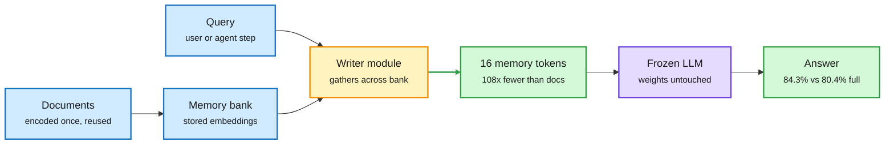

# Memorilla: a whole document collection in 16 memory tokens

**TL;DR.** Long context is expensive because every retrieved document is paid for again in prefill and stored again in the KV cache (the saved attention keys and values for every token in context). Memorilla (Stanford and Toronto) encodes each document once into reusable embeddings. For each query, a learned module reads across the whole collection and writes what matters into just 16 "memory tokens" placed in a frozen LLM's input embedding space. On FactKG it scores 84.33% against 80.43% with the full documents in context, while using 108x fewer tokens for the source material. It beats Mem0, MemoRAG and other baselines on five of eight benchmarks. Used as agent memory over the agent's own history in TextWorld, success rises from 18.6% to 24.2% and the agent revisits fewer rooms. Surfaced by DAIR Academy and Elvis Saravia on X.

Encode once, read 16 tokens per query

The frozen LLM never sees the documents, only a query-specific 16-token summary in its own embedding space.

Blue is stored and incoming data, amber is the learned writer, purple is the frozen model, green is the compressed memory and the answer.

## Key findings

- **16 tokens beat full context on FactKG** (84.33% vs 80.43%) with 108x fewer source tokens.
- **Five of eight benchmarks** won against Mem0, MemoRAG and other memory baselines.
- **Agent memory works too:** TextWorld success 18.6% to 24.2% when the collection is the agent's own trajectory.
- The base LLM stays **frozen**. Only the writer is trained, so the method plugs into an existing model.

## Relation to prior wiki pages

- **A third route** next to the two the [parametric-context-internalization](parametric-context-internalization.md) page tracks. That page separates compressing tokens and caching smarter from putting context into weights through a predicted adapter. Memorilla compresses into soft input tokens per query: no weight change, no KV eviction.
- **Extends** the [kv-cache](kv-cache.md) thread "never build the long cache" (10-07): the cheapest cache is the one that is never built. Here the whole collection costs 16 positions of KV.
- **Pairs with** Amazon's FEB-30 (same window, [agent shorts](../agentic-systems/2026-10-19-agent-shorts-memory-audit-data-world.md)), which shows QA scores hide whether a memory store holds the right facts. Memorilla is evaluated on QA, so the same caution applies.

## Gaps

No exact-recall or needle tests reported in the material seen, which is where soft-prompt compression usually breaks. No latency or writer cost per query. FactKG favors fact verification, where a summary may beat noisy full text.
