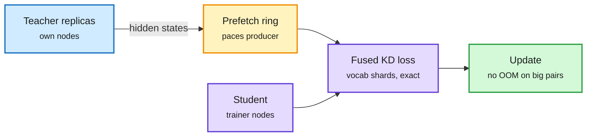

# Distillation shorts: DisaggKD, OPMD, TreeOPSD

**Sources:** HuggingFace daily papers 2026-10-19: [DisaggKD, 2610.17644](https://arxiv.org/abs/2610.17644); [OPMD, 2610.14022](https://arxiv.org/abs/2610.14022); [TreeOPSD, 2610.23181](https://arxiv.org/abs/2610.23181). Raw: `raw/huggingface/2026-10-19-disaggkd-*`, `-opmd-*`, `-tree-aware-*`.

## TL;DR

- **DisaggKD (systems).** Knowledge distillation (training a small student to match a big teacher) usually puts both models on the same GPUs, so GPU memory caps the teacher size. DisaggKD puts teacher replicas on separate nodes that stream hidden states to the student. A fused loss computed over row windows and vocabulary shards equals the full-vocabulary KD loss exactly, without ever materializing full logits. A prefetch ring paces the two sides. Qwen3.5-35B-A3B to 9B: the split layout matches the colocated LM loss and runs faster. On larger pairs the colocated run goes OOM where the split trains. Closed-form memory and traffic models say which layout to pick.
- **OPMD (method).** On-policy distillation supervises only outputs. OPMD also transfers intermediate computation, first mapping teacher states into a "student-compatible" form the student's later layers can use, then learning them on the student's own rollouts. Best average accuracy among distillation baselines in all three teacher-student settings; works multi-teacher and cross-family.
- **TreeOPSD (agentic RL).** Branches alternative continuations at each turn, backs terminal rewards up the tree into turn-level credit, and maps each credit to a bounded closed-form teacher distribution. Critic-free; bounds how far sequential mini-batch updates can overshoot.

DisaggKD: teacher and student stop sharing a GPU

Hidden states move over the network; the fused loss never builds full-vocabulary logits.

Blue is the teacher side, amber is pacing, purple is the student and loss, green is the result.

## How this relates to prior wiki pages

- **DisaggKD is P-D disaggregation for training.** The same move the AWS vLLM posts (today) make for serving: split two phases with different memory profiles across nodes and pay with a fast interconnect. See [knowledge-distillation](knowledge-distillation.md).
- **OPMD extends the hidden-state distillation line** that OPRD and Waypoint OPD (10-17, on-policy distillation with intermediate waypoints) opened: supervision is moving inside the model.
- **TreeOPSD** joins Tree-structured credit work in [rl-for-llms](../llms-foundation-models/rl-for-llms.md).
