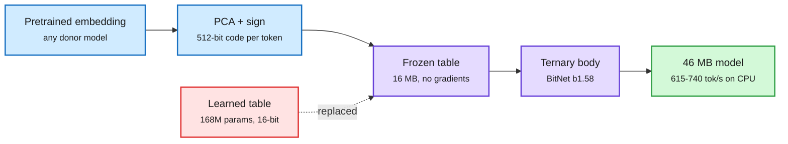

# Embeddings Are Overpriced? A frozen 16 MB vocabulary for small and ternary LMs

**Source:** HuggingFace daily papers 2026-10-19 ([arXiv 2610.22428](https://arxiv.org/abs/2610.22428)). Raw: [`raw/huggingface/2026-10-19-embeddings-are-overpriced-a-frozen-16-mb-vocabulary-for-smal.md`](../../raw/huggingface/2026-10-19-embeddings-are-overpriced-a-frozen-16-mb-vocabulary-for-smal.md)

## TL;DR

In small models the embedding table dominates. In Gemma 3 270M it holds **168M of 268M parameters**, and since quantizers leave embeddings at 16 bits, it is most of the file after compression. The paper replaces it with **one frozen table of 512-bit codes (16 MB, zero trainable parameters)**, made once by projecting a pretrained embedding onto principal components and keeping only the signs. Training the same Gemma-shaped body from scratch on 2.05B tokens: the learned table buys **0.20 nats** of validation loss for **2.6x the trainable parameters**, yet the frozen model ties or wins on LAMBADA, HellaSwag and PIQA (ARC-Easy favors learned). With a **ternary BitNet b1.58 body** the whole model is a **46 MB file**, ties the float model on LAMBADA and PIQA, and runs **615-740 tokens/s on a laptop CPU in 62 MB**, 5-6x the speed of the float model's 8-bit GGUF at a seventh of the memory. It also wins by 1.7-2.3 nats on rare words and absorbs 10,000 new words after training at a 3% cost, where the learned table degrades 43%.

Binarize the vocabulary once, train only the body

The table that was most of the model becomes a fixed 16 MB lookup.

Blue is the one-time construction, purple is what runs, green is the result, red is what was removed.

## Key findings

- The loss gap (0.20 nats) does not show up on most downstream tasks at this scale.
- Rare-word and new-word behavior favors the frozen code: there is no per-token parameter to under-train.
- Everything released: weights, data, every eval answer.

## How this relates to prior wiki pages

- **Extends the [conditional-memory-embeddings](conditional-memory-embeddings.md) thread**, which treats embedding tables as a memory budget to be reshaped rather than a fixed cost. This paper takes the extreme position: the table needs no learning at all at sub-1B scale.
- **Fills a gap in [quantization](quantization.md):** ternary and 4-bit work has compressed the body for months while leaving the embedding in 16 bits. Here the embedding becomes 1-bit by construction.

## Gaps

- Tested only at ~270M scale and 2.05B tokens. Embeddings are a small fraction of a 7B+ model, so the payoff shrinks with size.
- The donor embedding still came from a trained model; the method is "free" only after someone paid for it once.
