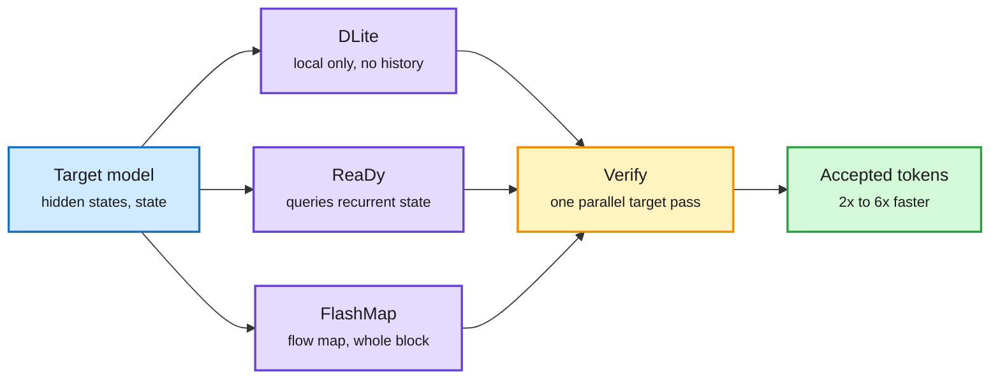

# Speculative drafting for agents and hybrids: DLite, ReaDy, FlashMap, Speculators v0.9

**Sources:** HuggingFace daily papers 2026-10-19 ([DLite, 2610.23787](https://arxiv.org/abs/2610.23787); [ReaDy, 2610.20503](https://arxiv.org/abs/2610.20503)); X home feed ([FlashMap, 2610.24365](https://arxiv.org/abs/2610.24365), [project page](https://jshen.net/flashmap)); vLLM [Speculators v0.9.0](https://github.com/vllm-project/speculators/releases/tag/v0.9.0) (Red Hat AI on X). Raw: [`raw/huggingface/2026-10-19-dlite-history-free-speculative-decoding-for-agentic-ai.md`](../../raw/huggingface/2026-10-19-dlite-history-free-speculative-decoding-for-agentic-ai.md), [`raw/huggingface/2026-10-19-ready-recurrent-states-as-dynamic-context-for-speculative-dr.md`](../../raw/huggingface/2026-10-19-ready-recurrent-states-as-dynamic-context-for-speculative-dr.md)

## TL;DR

Speculative decoding has a small drafter guess a block of tokens that the big model checks in one pass. Three papers in one window attack the drafter's context. **DLite** finds drafters lose up to **80% of acceptance length** on long, evolving agent contexts, and keeping the drafter's own KV history is costly. Its fix is to drop the history: reuse the target's hidden states, predict locally, and restore in-block order with a light sequential head. It reports acceptance length 2-6 and up to **70% better than DSpark**. **ReaDy** goes the other way for hybrid linear-attention models: it gives each draft position a learned query into the target's compact recurrent state. **3.16x** over plain decoding on Qwen3.8-27B on one B200, +8.5% acceptance and +8% throughput over DSpark. **FlashMap** replaces block-diffusion drafting (which predicts each block token independently) with a flow-map drafter that captures token dependencies in one pass: **up to 6.1x lossless** on Qwen3-8B, 7% more average speedup than a matched DFlash. Speculators v0.9 makes drafter training cheaper (fused loss kernel up to 2x faster forward on ~1B drafters, FP8 hidden-state storage halves disk).

Three answers to "what should the drafter look at?"

Same target model; the drafter's context source is the only thing that changes.

Blue is the target's signal, purple are the three drafter designs, amber is verification, green is the output.

## Key findings

- **DLite (agentic)**: the growing history is the shared cause of low acceptance and high system overhead. Removing it turns a hard long-context modeling problem into a local one. Two-stage training for the mixed architecture. Evaluated on general, long-context and agentic workloads.
- **ReaDy (hybrid linear attention)**: the first drafter to read HLA recurrent states; low-rank reads and fused operators keep I/O small. Builds on DSpark's parallel backbone and sequential head. 7 benchmarks across math, code and dialogue.
- **FlashMap**: one forward pass like DFlash, but conditioned flow map captures inter-token dependence. Lossless speedup, Qwen3-8B only.
- **Speculators v0.9**: training-side tooling, not a method. Lowers the cost of making per-model drafters.

## How this relates to prior wiki pages

- **Answers the open question from 10-16 and 10-17.** DFlash2 (shipped with Muse Spark Open, 10-16) showed acceptance falling from 3.73 to 2.16 on high-entropy prompts and 3.30 at 32K; the [speculative-decoding](speculative-decoding.md) page flagged "acceptance on long agentic traces" as still open. DLite quantifies the drop (up to 80%) and names history as the cause.
- **Contradiction worth tracking:** DLite says throw away history; ReaDy says read more of it (via a compact state). Both beat DSpark. They are compatible only if the problem is the drafter maintaining its own long KV, not access to context per se. ReaDy's context is the target's fixed-size state, which costs nothing to keep.
- **Parallel drafting is now n≥5:** DFlash2 (10-16), DSpine (10-17, depth-conditioned parallel drafting), DCOCO (10-13), FlashMap and DLite/ReaDy (both DSpark-based). One-pass block drafting is the default; the race is about dependencies inside the block.

## Open questions

- None of the three reports wall-clock under batched serving with real agent traffic.
- DLite's "up to 70%" over DSpark is a best case; the average is not given in the abstract.
