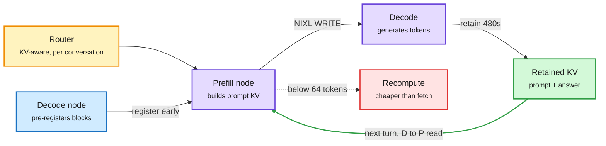

# vLLM KV transfer, two ways: push it early, and send it back

**Source:** AWS Machine Learning blog, two posts on 2026-10-19 ([push-based NIXL connector](https://aws.amazon.com/blogs/machine-learning/push-based-kv-transfer-to-improve-ttft-and-tpot-for-disaggregated-inference-in-vllm/), [bi-directional KV transfer](https://aws.amazon.com/blogs/machine-learning/improve-ttft-for-multi-turn-agentic-workloads-with-bi-directional-kv-transfer-in-vllm/)). Raw: [`raw/labs/2026-10-20-100728-labs.md`](../../raw/labs/2026-10-20-100728-labs.md)

## TL;DR

In prefill-decode (P-D) disaggregation, one GPU pool builds the KV cache (the stored attention keys and values for the prompt) and another pool generates tokens from it. The cache has to move between them, and AWS shows that how it moves matters as much as the network. **Push mode** lets the decode node reserve its destination blocks while prefill is still running, so the prefill node writes the cache straight in the moment it is ready: up to **3x better TTFT** (time to first token) and **30% better TPOT** (time per output token) for Qwen3-32B at 8 QPS and 16K input (1,744 ms to ~540 ms). **Bi-directional transfer** sends the decode node's cache (prompt plus generated answer) back to prefill on the next agent turn instead of recomputing it: TTFT down **1.6x for Qwen3-32B and 3.3x for GLM-5-FP8** at 20-24K context. Both were built on Trainium, upstreamed to vLLM as accelerator-agnostic features, and measured on P5en (H200) GPUs over EFA RDMA.

The cache stops waiting for paperwork, and stops being thrown away

Push moves setup off the critical path; the return path turns a full recompute into a short read.

Amber is the router, purple are the two GPU pools, green is the reused cache, red is the fallback recompute.

## Key findings

- **Pull mode serializes three steps after prefill**: router relays block IDs, decode allocates, decode issues a NIXL READ. Push mode overlaps registration with prefill and hands the transfer to a background thread on the prefill worker, so neither main loop stalls.
- **Push costs routing flexibility.** Decode must be chosen before prefill finishes, so load-aware late binding of the decode node is lost. In return, prefill frees its blocks sooner.
- **Gap opens only under load.** At low QPS and short prompts the two modes tie. At 8 QPS / 16K, pull's inline descriptor posting stalls token generation.
- **Bi-directional retention TTL** (`decoder_kv_blocks_ttl`, default 480 s) keeps the conversation's KV on the decode node for the next turn; **recompute threshold** (`kv_recompute_threshold`, default 64 tokens) recomputes short prefixes because fetch overhead beats compute there.
- Transfer adds 30-130 ms but removes far more prefill: Qwen3-32B prefill 128-414 ms with reuse vs 153-744 ms without; GLM-5-FP8 316-541 ms vs 500-2,331 ms. Bigger models gain more because per-token recompute is dearer.
- Both benchmarks disable prefix caching to isolate the transfer, so real gains depend on how often the local prefix cache already hits.

## How this relates to prior wiki pages

- **Confirms and extends the remote-KV break-even line** ([10-17](2026-10-17-remote-kv-tier-slower-than-gpu.md), which found that on B300s a remote cache hit only beats recompute above ~17K tokens). AWS sets the break-even at 64 tokens because the "remote" tier here is a peer GPU over RDMA, not a storage server. The break-even is a property of the tier, not of KV reuse in general.
- **Agentic multi-turn is now the design target.** The bi-directional post is explicitly about agent loops that resend growing histories, the same workload where DLite (today) finds drafters lose 80% of acceptance length. See [kv-cache](kv-cache.md).
- **Routing and caching merge.** The KV-aware router keyed on `conversation_id` is a cache-locality router, the serving-side twin of llm-d's block-tracking scheduler (PyTorch Conference poster, 10-20). See [llm-routing](../ai-routing/llm-routing.md).

## Open questions

- No numbers with prefix caching on, and only 1P1D. How does push behave when many prefill nodes compete for one decode node?
- The fixed TTL is not renewed; AWS itself names a heartbeat lease as the next step. Idle agent sessions will pin HBM until then.
