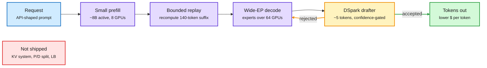

# DeepInfer: DeepSeek open-sources the engine behind V4.1-Flash (plus LFM2.5-DSpark drafters)

**Date:** 2026-10-21 · **Sources:** [DeepSeek on X](https://x.com/deepseek_ai/status/2112476496283775135), [GitHub](http://github.com/deepseek-ai/DeepInfer), [The Decoder](https://the-decoder.com/deepseek-open-sources-the-inference-engine-that-powers-its-fastest-and-cheapest-ai-model/), AI Weekly Espresso (10-20), community breakdowns by [@bookwormengr](https://x.com/bookwormengr/status/2112636749293949122) and [@rohanpaul_ai](https://x.com/rohanpaul_ai/status/2112517682646155349); [LiquidAI LFM2.5-24B-A2B-DSpark](https://huggingface.co/LiquidAI/LFM2.5-24B-A2B-DSpark) (labs watcher). Raw: `raw/rss/2026-10-20-the-decoder-deepseek-open-sources-the-inference-engine-that-powers.md`, `raw/labs/2026-10-21-203321-labs.md`, X feed captures 10-20 evening.

## TL;DR

DeepSeek released DeepInfer, the inference framework that serves DeepSeek-V4.1-Flash in production, under Apache 2.0. It targets NVIDIA SM100 (Blackwell) GPUs and Huawei Ascend 950 NPUs and only runs V4.1-Flash. What ships is the speed layer: optimized kernels, wide expert parallelism, the DSpark speculative drafter (up to ~5 tokens ahead, with confidence-scheduled verification), and "bounded replay" that recomputes only a 140-token suffix sized to the sliding attention window instead of re-prefilling. What does not ship, per Rohan Paul's read of the repo: the KV cache system, prefill/decode disaggregation and cross-replica load balancing. A companion `deepseek-recipe` library maps Chat Completions / Responses / Messages requests onto V4/V4.1 prompts so community deployments match the official API. It passed 6.3K GitHub stars in about 8 hours. The same day Liquid AI shipped DSpark-style drafters for its whole LFM2.5 family, so DSpark is now a named drafter design with two independent production users.

The cost cut is stacked, not one trick

Each box removes a different slice of work; DeepInfer open-sources the speed layer, not the service layer.

Blue is input, purple is compute DeepInfer ships, amber is the speculative loop, green is output, red is what stays private.

## Key points

- **Where the efficiency comes from (community analysis, not DeepSeek's paper):** Engram-style conditional memory removes ~30% of parameter compute by reading embedding rows selectively; prefill activates ~8B params per token vs ~16B for decode, so only 8 GPUs of an NVL72 rack do prefill; decode spreads experts across 64 GPUs (DP64 + EP64, ~45B mostly 4-bit params per GPU), leaving most HBM for KV; KV reuse is claimed to cut KV per token ~400x vs a GQA baseline; NVLink moves KV from prefill to decode GPUs; DSpark accepts up to ~4 tokens on code.
- **Tension in the reports:** one reading says disaggregation is described in the deployment, the other says the disaggregation and KV-cache layers are exactly what was held back. Both can be true: DeepSeek runs disaggregated, but open-sourced the per-engine kernels only.
- **Ascend 950 support** puts the same engine on Huawei silicon that DeepSeek said it will pre-train on by end-2026. The same week DHS ordered DeepSeek products (including third-party products built on DeepSeek tech) out of federal civilian systems.
- **LFM2.5-24B-A2B-DSpark (Liquid AI):** a 327.7M-param drafter (5 full-attention layers, block size 9, a rank-256 "Markov head" plus a confidence head) for a 24B-A2B MoE. On B300 with an FP8 target in SGLang: 2.4x average output throughput at concurrency 1 (up to 3.1x), 1.7x at concurrency 256. Drafters ship for 1.2B, 2.6B, VL-3B, 8B-A1B and 24B-A2B targets, plus GGUF for llama.cpp.

## Relation to prior wiki pages

- **Confirms the speculative-decoding page's 10-17 comparison set:** DSpine was benchmarked against DFlash2 and DSpark on acceptance length. DSpark is now in two shipping stacks (DeepSeek, Liquid), which moves it from "a baseline" to "a production default". See [speculative-decoding](speculative-decoding.md).
- **Extends [conditional-memory-embeddings](conditional-memory-embeddings.md):** the page's central claim (token-ID-addressed lookups are a systems win because the address is known before any layer runs) now has an open-source serving engine built around it. Same day, the [N-gram memories at two bits](2026-10-21-memory-native-and-prefill-pruning-shorts.md) paper cuts DeepSeek's table from 203 GB to 51 GB.
- **KV-cache page tension (10-20):** the vLLM push-mode KV transfer work showed disaggregation lives or dies on the KV transport layer. DeepInfer withholds exactly that layer, so the hard part of reproducing DeepSeek's cost curve is still private.

## Open questions

- Will the community rebuild the missing KV/disaggregation layer on top of vLLM or llm-d 1.0 (released the same day at PyTorchCon), and how close to DeepSeek's API price does that get?
- DSpark acceptance on long agentic traces: DLite (10-20) showed drafters lose up to 80% of acceptance length there.
