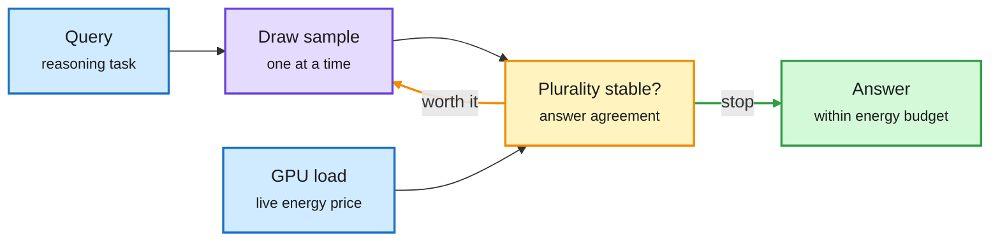

# Test-time compute meets the real GPU: ATEST and implicit budgeting under composition

**Sources:** HuggingFace daily papers 2026-10-21: [ATEST: Adaptive Resource-Aware Test-Time Scaling for LLM Inference, 2610.25519](https://arxiv.org/abs/2610.25519); [On the Fragility of Tasks under Composition: Implicit Budgeting in Language Models, 2610.27190](https://arxiv.org/abs/2610.27190). Raw: `raw/huggingface/2026-10-21-atest-*`, `raw/huggingface/2026-10-21-on-the-fragility-*`.

## TL;DR

- **ATEST** measures something test-time-scaling papers ignore: the energy cost of the same 4-sample query rises **up to 4.1x** as GPU load rises. ATEST-Online samples answers one at a time, tracks how stable the plurality answer is, watches live GPU conditions, learns per-step energy cost online, and stops when another sample is not worth its current price. On four A100 datasets it answers every query within the energy budget at the best or tied accuracy. On GSM8K at high load: **60.0% with no deferrals vs 44.0% and 42.4% deferrals** for the offline-calibrated variant. Including profiling, Online uses **42x less GPU time and 48x less energy** than Calibrated. Cost: higher tail latency and lower throughput on short tasks.
- **Implicit budgeting**: models (open-weight and Claude Opus 5) make more errors when several tasks share one prompt, beyond what independent errors predict. The cause: under composition they spend far fewer reasoning tokens per task, even well within the context window. Tasks needing long traces are the fragile ones; easy tasks get more reasoning than they need in isolation. Grouping tasks by fragility **cuts token use 43%** at preserved accuracy.

The price of one more sample changes every second

ATEST stops sampling on answer stability and live GPU cost, not a fixed N.

Blue is input and live cost, amber is the stop rule (loop in amber), green is the exit.

## How this relates to prior wiki pages

- **Extends [test-time-compute-allocation](test-time-compute-allocation.md)** from "how hard is this query" to "how expensive is compute right now." Prior allocation work (CLEAR's shadow price across a batch, LEV's fitted stopper on 10-20 saving 15-24% compute) priced compute as constant. ATEST makes the price a live signal.
- **Implicit budgeting is the prompt-level face of the same problem**: the model allocates reasoning tokens by an internal budget that is blind to per-task difficulty when tasks are packed together. Connects to the 10-20 LEV result (depth chosen per question) and to batch-level routing on [llm-routing](../ai-routing/llm-routing.md).

## Gaps

- ATEST: small models (Phi-3-mini, Qwen2.5-3B) under controlled synthetic load; no production traffic.
- Implicit budgeting: the 43% saving is on math and linguistic tasks; agentic multi-task prompts untested.

## Research angle

Combine the two: a serving-side scheduler that knows live GPU price (ATEST) and splits composite prompts by fragility (implicit budgeting) could cut both energy and errors on multi-task requests.
