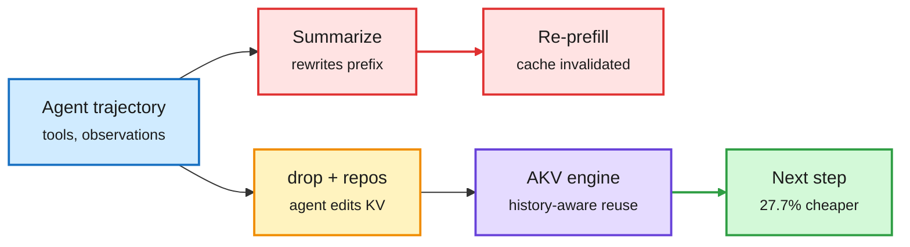

# Cache Engineering for Agents: drop, repos, and the AKV serving engine

**Source:** surfaced via the X Following feed (DAIR.AI post, 2026-10-21); paper [Cache Engineering for Agents, 2610.28577](https://arxiv.org/abs/2610.28577) (Tsinghua). Not on the HuggingFace list in this window. Raw: `raw/twitter/feed/2026-10-21-*-ranked.json` (gitignored).

## TL;DR

Long agent trajectories make KV-cache I/O and storage the dominant cost. The usual fix, context engineering, trims or summarizes history. But editing the prefix invalidates every cached state after the edit, so the kept context must be prefilled again, and trimming too little to save prefill hurts accuracy. **Cache engineering** gives the agent two operations on its own KV cache instead: **`drop`** excludes selected entries from future attention, and **`repos`** shifts the position encodings of the keys that remain. The trajectory text never changes and nothing is re-prefilled. This creates a serving problem: the same token sequence can map to different cache states depending on the operation history, so plain prefix matching is no longer a correct cache key. The **AKV** engine keeps a stateless API outward and manages stateful reuse, eviction and restoration inside. A rolling drop of old tool responses scores **+1.7 points at 27.7% lower cost** than threshold-triggered summarization; AKV adds **up to 1.2x output throughput and 1.5x faster P95 latency**; self-improving cache policies cut cost another 7.1% versus expert-designed policies.

Edit the cache, not the transcript

Summarizing rewrites the prefix and forces re-prefill; drop and repos leave the text alone.

Red is the summarize-and-re-prefill path, amber is the agent's cache operation, purple is the serving engine, green is the saving.

## How this relates to prior wiki pages

- **Bridges [kv-cache](kv-cache.md) and [agent-harness-engineering](../agentic-systems/agent-harness-engineering.md).** The 10-20 pattern "selection beats compression" (n=5: Memorilla, Thin Orchestrator, CQ2-CARE, CarryOn, Librarian) was all harness-level. Cache engineering moves the selection one layer down, into the KV cache, and makes it free of re-prefill. Sixth instance of the pattern.
- **Extends vLLM's bi-directional KV transfer (10-20)**, which keeps a session's KV warm across turns. Both treat the multi-turn agent session, not the request, as the unit of caching. AKV adds that the cache key must include the operation history.
- **Prefill-side sibling of TokenGate (today):** TokenGate decides which input tokens never enter the cache; cache engineering decides which entries leave it later. Together they cover both ends.
- **Open question it creates for prefix caching:** history-dependent cache states break the radix-tree prefix matching that SGLang and vLLM rely on.

## Gaps

- Abstract does not say how `repos` affects quality on tasks that need exact positional recall.
- AKV's restoration cost when a dropped entry is needed again is not quantified.
- Benchmarks and models are not named in the abstract.

## Research angle

Can `drop` decisions be learned from attention statistics during the run (like H2O-style eviction) rather than chosen by agent policy? If the agent's own semantic choice beats attention-score eviction, that is evidence task structure matters more than attention mass for agent caches.
