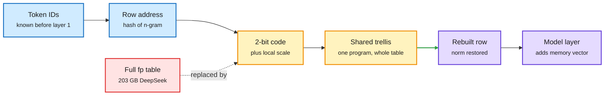

# N-Gram Memories at Two Bits: compressing Engram-style lookup tables (Conditional Program)

**Source:** HuggingFace daily papers 2026-10-20 (captured late, in the 2026-10-22 window): [N-Gram Memories at Two Bits: Quantizing Lookup Tables in Large Language Models, 2610.21810](https://arxiv.org/abs/2610.21810). Raw: `raw/huggingface/2026-10-20-n-gram-memories-at-two-bits-quantizing-lookup-tables-in-larg.md`.

## TL;DR

Conditional memory (an n-gram lookup table the model reads by token ID, as in DeepSeek's Engram) adds capacity cheaply in compute but expensively in storage: the whole table must stay addressable for any input. Conditional Program (CP) stores each row as a short code plus a local scale, and shares one reconstruction program (a Gaussian trellis with norm restoration) across the whole table. Rows decode independently, so the runtime rebuilds only the rows an input asks for. At **2 bits per weight CP lowers output KL by 41-63%** versus 2-bit round-to-nearest. On DeepSeek's table it cuts storage from **203 GB to 51 GB**, small enough to keep the table on GPU instead of host memory.

Store a recipe per row, not the row

Only rows the input touches are rebuilt; the shared trellis is the whole trick.

Blue is addressing, amber is the compressed representation, purple is what the model consumes, red is the storage it replaces.

## Key findings

- **Two-bit codes, shared decoder.** Each row is a short code and a scale; the trellis reconstruction program is shared, so per-row overhead is tiny and rows decode independently (no block dependency, so random access stays cheap).
- **Learned tables look Gaussian per coordinate but carry row-to-row structure.** At matched storage the shared trellis beats fitted codebooks and low-rank residual variants across three trained n-gram memory families.
- **41-63% lower output KL than 2-bit RTN**; DeepSeek table 203 GB to 51 GB (4x).

## How this relates to prior wiki pages

- **Answers a storage objection on [conditional-memory-embeddings](conditional-memory-embeddings.md).** That page has tracked a split between token-ID addressing (Engram, COUNT on 10-16: prefetchable from host RAM) and hidden-state addressing (MoME: context-sensitive, not prefetchable). The token-ID camp's argument was "put the table in cheap memory and prefetch." CP offers the other route: shrink the table 4x so it fits in HBM and no prefetch is needed.
- **Same principle as [quantization](quantization.md) of KV cache and weights**, applied to a parameter type that is huge but sparsely touched. Rarely touched parameters tolerate aggressive codes because error only lands where the row is read.
- Relates to the 10-16 COUNT result (parameter-free count tables on host RAM): COUNT removes the learned table entirely; CP keeps it but compresses. Which wins depends on whether learned rows carry signal counts cannot.

## Gaps

- Abstract reports KL, not downstream task accuracy at full model scale.
- Decode latency of the trellis per row and how it overlaps with layer compute is not given.
- No comparison against simply moving the uncompressed table to host memory with prefetch.

## Research angle

Does the "Gaussian coordinates + structured rows" finding hold for MoE expert weights that are also rarely touched? If yes, a single shared-trellis codec could serve both Engram tables and cold experts.
