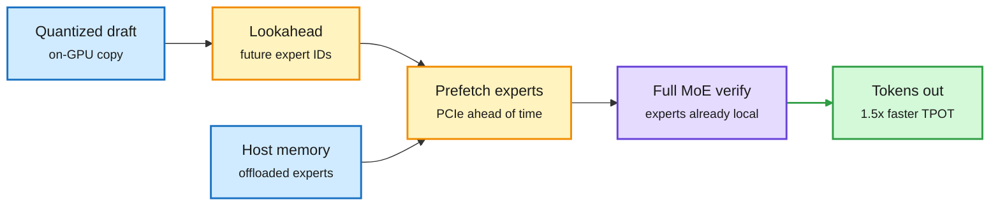

# Speculation four ways: Specter, DScout, ECHO, Lafa

**Sources:** HuggingFace daily papers 2026-10-20/21: [Specter, 2511.14102](https://arxiv.org/abs/2511.14102) ([code](https://github.com/wwwwwf/specter_asplos)); [DScout (Factorization-Guided Diffusion-Drafted Speculative Decoding), 2610.23935](https://arxiv.org/abs/2610.23935); [ECHO, 2610.24766](https://arxiv.org/abs/2610.24766); [Lafa (Large Flow Language Models), 2610.28559](https://arxiv.org/abs/2610.28559). Raw: `raw/huggingface/2026-10-2[01]-*` matching slugs.

## TL;DR

- **Specter** (ASPLOS): MoE models too big for one GPU offload experts to host memory, and PCIe transfers sit on the critical path because routing is data-dependent. Specter runs a small **quantized draft copy** of the model on-device. Its expert choices track the full model's closely, so drafting several tokens ahead tells the runtime which experts it will need, and transfers start before verification. **1.50x average (up to 1.88x) lower time per output token** than the best prior offloading system, single request.
- **DScout**: diffusion drafters propose many tokens in parallel, but verification only accepts a consecutive prefix, so one early miss wastes the rest. DScout splits the training loss into inclusion, weighting and prediction terms, and weights by acceptance. At inference it treats throughput as mean accepted tokens divided by per-round latency and picks drafter depth and block size per workload. **3.84x / 4.14x over autoregressive on Qwen3-4B / 8B**, +9.1% / +7.1% over the best baseline.
- **ECHO**: multi-token prediction (MTP) normally adds a head per extra horizon. ECHO makes the backbone's own last layer predict every horizon, with Dynamic Depth Sampling so deep horizons are trained rarely. Half the MTP training overhead; gains concentrate on reasoning and code; the pretrained model is its own drafter and keeps draft-target alignment on high-entropy text where post-hoc drafters degrade.
- **Lafa**: a blockwise continuous-flow language model (causal across blocks, bidirectional flow inside a block) adapted from AR checkpoints with **under 30B tokens** at 0.5B/7B/8B. Flow training adds an MTP-like effect, used for self-speculative decoding: **2.54x AR throughput** at comparable quality, beating MTP and discrete diffusion.

The drafter is now a scheduler, not just a guesser

Specter uses draft tokens to predict which experts to fetch; the others redesign who drafts.

Blue holds weights, amber is the scheduling decision the draft enables, purple verifies, green is the result.

## How this relates to prior wiki pages

- **Specter generalizes the 09-28 FreeToken idea** (serve rarely-used MoE experts from cheap memory on consumer GPUs, [conditional-memory-embeddings](conditional-memory-embeddings.md)) by making the prediction of "which expert next" come from speculative drafting. Same principle as today's CP paper for Engram tables: rarely touched parameters belong in cheap memory if the touch is predictable.
- **DScout and Lafa extend the diffusion/flow-drafter line on [speculative-decoding](speculative-decoding.md)** (FlashMap on 10-20: flow-map drafter, up to 6.1x lossless on Qwen3-8B). DScout's "MAT is not throughput" point is the same lesson DLite (10-20) drew from long agentic contexts: optimize accepted-per-second, not accepted-per-round.
- **ECHO answers the 10-16 open question on drafter alignment on high-entropy text** from the training side: a model trained to predict its own future does not drift from itself.

## Gaps

- Specter: single-request only; batching changes expert reuse patterns entirely.
- DScout: Qwen3 4B/8B only; no agentic long-context traces.
- ECHO: abstract gives no wall-clock speedup numbers.
- Lafa: "comparable quality" needs task-level numbers.

## Research angle

Specter's insight (draft tokens as a prefetch oracle) should apply to KV offloading too: a draft that predicts which cached blocks attention will hit next could prefetch from CPU or NVMe tiers.
