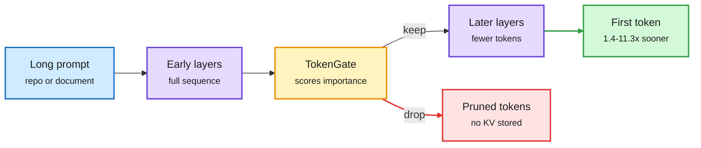

# TokenGate: learned token pruning for fast, memory-light prefill

**Source:** HuggingFace daily papers 2026-10-20 (late, in the 2026-10-22 window): [TokenGate: Adapting LLMs for Fast and Memory-Efficient Prefill with Learned Token Pruning, 2610.26754](https://arxiv.org/abs/2610.26754). Code: [github.com/tokengate-models/TokenGate](https://github.com/tokengate-models/TokenGate). Raw: `raw/huggingface/2026-10-20-tokengate-adapting-llms-for-fast-and-memory-efficient-prefil.md`.

## TL;DR

Models read every input token through every layer, so long prompts (repos, long documents) make prefill slow and memory-heavy. TokenGate adds a small drop-in module that scores token importance and drops low-value tokens as they pass through the layers, like a reader skimming. The hard part is that "keep the top K tokens" is not differentiable. TokenGate fixes that with **token-gated attention**: borrowing from mixture-of-experts gating, importance scores re-weight the attention logits during training, so the pruner learns end to end. Results: **1.4-11.3x faster time-to-first-token and 1.5-3.4x lower peak memory with no accuracy loss**, up to 6.4x faster prefill and 2x lower memory than the best prior pruning method. Works on standard transformers (Qwen3) and hybrid-attention models (Qwen3.5) with PEFT-scale adaptation.

Skim first, read closely only what survives

The gate learns which tokens later layers never need, so they never enter the KV cache.

Amber is the learned gate, red is what never reaches the cache, green is the latency payoff.

## How this relates to prior wiki pages

- **Prefill-side complement to the decode-side eviction work on [kv-cache](kv-cache.md).** Most eviction papers (DropKV in this week's Kurate top-20; TideKV, delayed eviction via layer-wise chunked prefill, also on Kurate) decide what to forget after the cache exists. TokenGate decides what never gets written.
- **Echoes the 10-20 "selection beats compression" pattern** ([agent-context-cost-shorts](../agentic-systems/2026-10-20-agent-context-cost-shorts.md)) inside the model rather than in the harness: deciding which tokens matter beats squeezing all of them.
- **Tension with CQ2-CARE (10-20)**, which found compressors break exact code edits. TokenGate claims no accuracy loss, but its tasks are not reported as exact-edit code tasks in the abstract.
- See [model-pruning-sparsity](model-pruning-sparsity.md).

## Gaps

- Which tasks and context lengths produce the 11.3x end versus the 1.4x end is not in the abstract.
- Decode-time quality on multi-turn sessions where a pruned token becomes relevant later is untested.
- Interaction with prefix caching (pruning is query-dependent, which breaks cache sharing) is not discussed.

## Research angle

Query-dependent pruning conflicts with prefix-cache reuse. A useful follow-up: a query-independent pruning pass for shared prefixes plus a query-dependent pass only on the suffix.
