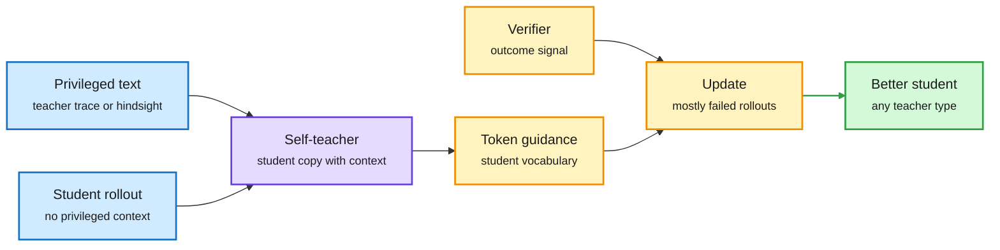

# Distillation shorts: text-only teachers, rewritten reasoning, retrospective self-teachers, a one-GPU agent

**Sources:**
- Bridged Self-Distillation for On-Policy Learning (BSD), [arXiv 2610.26397](https://arxiv.org/abs/2610.26397). HuggingFace 2026-10-22. Code: [github.com/TUMLegalTech/Bridged-Self-Distillation](https://github.com/TUMLegalTech/Bridged-Self-Distillation). Raw: `raw/huggingface/2026-10-22-bridged-self-distillation-for-on-policy-learning.md`.
- TraceForge: Distilling with Your Own Thinking, [arXiv 2610.29680](https://arxiv.org/abs/2610.29680). HuggingFace 2026-10-22. Raw: `raw/huggingface/2026-10-22-traceforge-distilling-with-your-own-thinking.md`.
- Self-Evolving Agents through Privileged Retrospective Distillation (RSD), [arXiv 2610.27495](https://arxiv.org/abs/2610.27495). Via X ([@rohanpaul_ai](https://x.com/rohanpaul_ai/status/2113509229298602311)); Meta.
- Muse Glimmer 30B: An On-Device Agentic Model, [arXiv 2610.24628](https://arxiv.org/abs/2610.24628). Via X ([@rohanpaul_ai](https://x.com/rohanpaul_ai/status/2113187339279433811)); Meta.

## TL;DR

Four results that make distillation work when the teacher gives you only text, or no teacher exists at all.

- **BSD** handles the three teacher cases (same tokenizer, different tokenizer, closed API) with one recipe. The external teacher writes a reasoning trace once, offline. The student rolls out without it. A copy of the student that *does* see the trace acts as a self-teacher and scores the student's rollouts token by token in the student's own vocabulary. That guidance only adjusts updates on failed rollouts; a verifier supplies the outcome signal. Because the teacher only emits text, API teachers work as well as open ones.
- **TraceForge** addresses closed models that return answers but hide their reasoning. It trains a generator to rewrite a context plus answer into a reasoning trace in the student family's own style, then an adversarial critic to judge authenticity. An independent judge rates generated traces 0.68 on authenticity vs 0.66 for real ones (0.82 for critic-selected). With the same 5,000 questions and teacher answers, **HumanEval+ +3.7 and MBPP+ +7.1** over training on Fable 5's own visible thinking. The claim: reasoning written in your own family's style is easier to learn from.
- **RSD** turns unlabeled agent experience into dense supervision. The same model is student and teacher; the teacher re-scores the student's realized actions while conditioning on cross-task lessons and hindsight from the finished trajectory. Up to **59.7% relative gain** on ALFWorld, ScienceWorld and SearchQA with Qwen3-8B/14B, plus up to 44.7% more when a frontier model edits how the privileged context is built.
- **Muse Glimmer 30B** distills Meta's larger Muse Spark into a dense 30B multimodal agent model trained on synthetic runs in mock apps, then quantizes to about 4-bit (under 20 GB, one RTX 5090). **MCPAtlas 75.5 vs 54.2 (Gemma4-31B) and 62.5 (Qwen3.6-27B)**; it still trails Qwen on OSWorld-Verified (65.9 vs 75.6). Apache 2.0.

The student's own copy becomes the teacher

BSD and RSD both condition a copy of the student on privileged text and score in the student's vocabulary.

Blue is input text and rollouts, purple is the self-teacher, amber is the scoring and update loop, green is the result.

## How this relates to prior wiki pages

- **Privileged-information self-distillation is now a family.** The 10-22 KL-contrast metric predicted which privileged information helps self-distillation ([ask-to-distill shorts](2026-10-22-distillation-shorts-ask-to-distill.md)). PR-OPD (10-14) found a skill hint moves under a quarter of token probabilities but over 80% of hidden states. BSD (teacher trace as privileged context) and RSD (hindsight as privileged context) are two more, which makes at least four papers in ten days using a context-conditioned copy of the student as teacher. See [knowledge-distillation](knowledge-distillation.md).
- **Cross-tokenizer distillation keeps converging on "go through text".** ActionOPD (10-16) distilled semantic actions from a black-box teacher with no shared tokenizer; BSD does the same for reasoning. Logit matching is losing to text-level transfer whenever teachers are closed.
- **TraceForge is the policy-side reaction to hidden reasoning.** It is a legal alternative to the trace-recovery attacks it mentions. It also implies a student learns best from traces in its own style, which echoes TIP (04-16: most teacher tokens carry no signal).
- **Muse Glimmer extends the 10-22 local-agent thread** (Recursive Flint, a 40B MoE with 2.5B active, runs locally for coding). Distillation plus 4-bit is what moves agent workloads to one consumer GPU. See [quantization](quantization.md) and [self-evolving-agents](../agentic-systems/self-evolving-agents.md) for RSD.

## Gaps

- BSD's abstract gives no numbers.
- TraceForge's authenticity score is a judge's opinion, not correctness; gains are on coding only.
- RSD's frontier-guided edits use a stronger model, so the "self" in self-evolving is partial.
- Muse Glimmer's OSWorld deficit suggests the synthetic mock apps cover tool use better than GUI use.

## Research angle

BSD and RSD both apply guidance mainly to failed rollouts. Nobody has measured how much of the self-teacher's signal on successful rollouts is wasted versus harmful. A per-rollout gate (apply guidance only when self-teacher and student disagree past a threshold) is a cheap ablation.
