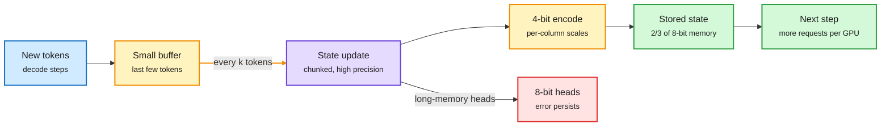

# PACE: four-bit recurrent state by rounding less often

**Source:** HuggingFace daily papers 2026-10-22: [PACE: Periodic and Channel-Aligned Encoding of Four-Bit Recurrent States, 2610.29545](https://arxiv.org/abs/2610.29545). Raw: `raw/huggingface/2026-10-22-pace-periodic-and-channel-aligned-encoding-of-four-bit-recur.md`. No alphaxiv overview yet; written from the abstract.

## TL;DR

Linear-attention and hybrid models keep context in a fixed-size recurrent state instead of a growing KV cache. A server holds one state per active request, so the state pool, not context length, sets how many requests fit on a GPU. Existing state quantizers round the state after every generated token, and that error compounds: four bits loses accuracy unless you add bits or fine-tune. **PACE** makes three changes. (1) **Round periodically:** keep the state in high precision across a few tokens, buffering the in-between tokens, and quantize once per period, mirroring what chunked kernels already do per chunk during prefill. (2) **Column-shared scales:** in gated-delta states the large entries cluster in columns, because some channels of the per-token update stay large across many tokens, so one scale per column fits the outliers. (3) **Mixed heads:** heads that hold rounding error longest stay at 8 bits. On four hybrids from 4B to 35B, mixed 4/8-bit PACE matches 8-bit DAMP on the three larger models at about **two thirds of its memory**, all-4-bit PACE beats Q-Mamba at equal memory, and periodic rounding keeps the decode speedup of the buffer.

Fewer roundings, less compounded error

The buffer turns per-token quantization into per-period quantization.

Amber is the buffer and quantizer, purple is the state update, red marks the heads kept at higher precision, green is the memory payoff.

## How this relates to prior wiki pages

- **Third paper in a month on low-bit recurrent state, and it agrees with the first two on the core point.** STEPQuant (10-09: allocate state bits by how long the gate keeps each entry, 6-bit cuts SGLang serving memory up to 68.7%) and DAMP (keep decay-selected channels in FP16, INT8 elsewhere) both say error lifetime is what matters. PACE attacks lifetime from the time axis: fewer rounding events means less compounding. STEPQuant attacks it from the bit-allocation axis. They should compose. See [quantization](quantization.md).
- **Partial progress on the 10-09 Looking Ahead** ("low-bit recurrent state ships in a serving stack within 90 days, signal by 2027-01-07"). PACE is post-hoc and reuses the chunked-kernel structure serving stacks already have, which lowers the integration cost. Still no release note.
- **Same column-outlier structure as weight/activation quantization.** Channel outliers forced per-channel scales in SmoothQuant-era LLM quantization; PACE finds the analogue inside the gated-delta state.
- Related: [kv-cache](kv-cache.md), [attention-mechanisms](../llms-foundation-models/attention-mechanisms.md).

## Gaps

- Throughput at fixed latency (requests per GPU) is implied but not stated in the abstract.
- The buffer adds a period-length window of full-precision state per request; memory accounting for that buffer at high concurrency is not given.
- No head-to-head with STEPQuant.

## Research angle

Make the period adaptive: round when the accumulated update norm crosses a threshold rather than every k tokens. That ties rounding frequency to how fast the state is actually changing, which should help bursty tool-output segments in agent traces.
