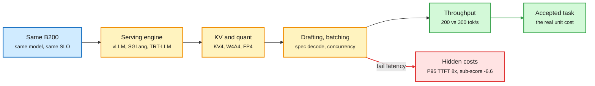

# The operator gap: same GPU, 50% more output, and the regressions averages hide

**Sources:**
- Oliver Kennon (SemiAnalysis), "Same GPU, 50% More Output: Why the Operator Matters," AI Engineer, 2026-10-20 ([video](https://www.youtube.com/watch?v=3axY1wz2OvA)). Raw: `raw/youtube-ai-tech/2026-10-20-SemiAnalysis-Same-GPU-50-Percent-More-Output-Operator-Matters.md`.
- MiniMax, "Faster model, test the whole job" (M3.1 Flash preview), AI Engineer, 2026-10-21 ([video](https://www.youtube.com/watch?v=YvQ4BVTWfHI)). Raw: `raw/youtube-ai-tech/2026-10-21-MiniMax-Faster-Model-Test-The-Whole-Job.md`.
- Red Hat AI, DFlash2 speculator for Gemma 4 31B ([model card](https://huggingface.co/RedHatAI/gemma-4-31B-it-speculator.dflash2), [post](https://x.com/RedHat_AI/status/2113327746776449489)); vLLM Wide-EP claim ([retweet](https://x.com/RedHat_AI/status/2113228111110348977)). Via X Following feed.
- MiniMax M3.1 Flash 428B launch acknowledged by NVIDIA AI Infra ([retweet](https://x.com/NVIDIAAI/status/2113452649035293153)).

## TL;DR

SemiAnalysis's InferenceX benchmark finds two serving stacks on identical B200s, same model, same 100 tok/s/user interactivity target and 8K-in/1K-out traffic, differing by about 50% in output throughput (roughly 200 vs 300 tok/s). The gap comes entirely from operator choices: serving engine, parallelism layout, batch size, KV-cache config, speculative decoding and quantization format. Kennon's north-star metric is **cost per successfully completed task at required quality**; $/GPU-hour is an input, not an output. MiniMax's M3.1 Flash talk is the same argument from the model side, with unusually honest failure data. M3.1 Flash uses block-sparse attention, **Q8/KV4** (8-bit queries, 4-bit keys and values), **W4A4 routed experts** with the shared expert left unquantized, and a new speculative head. The disclosed regressions are the real content: KV4 leaves the average flat but drops one sub-score 6.6 points; doubling concurrency from 32 to 64 buys 1.9x throughput but P95 time-to-first-token jumps from about 1.5 s to 11.6 s; dropping reasoning effort from max to high falls from 80% to 68% on a coding test. On the same day Red Hat shipped a DFlash2 drafter for Gemma 4 31B (5-layer draft, 4-7 of 7 drafted tokens accepted, about 1.4x throughput at high concurrency), and vLLM claimed Wide-EP plus EPLB matches DeepSeek DeepInfer's decode throughput.

The gap is in the stack, not the silicon

Every box between the GPU and the accepted answer is an operator choice that can cost or save half the output.

Blue is fixed hardware, amber is operator choices, red is the cost averages hide, green is the output that counts.

## Key claims

- **Operator spread ~1.5x on identical hardware** (SemiAnalysis InferenceX; the exact 200/300 figure is from the talk and not independently verified).
- **Security is part of "useful":** SemiAnalysis found a provider whose monitoring access exposed another customer's logs. ClusterMAX 3.0 rates a few hundred managed GPU clusters on provisioning, reliability, monitoring and security.
- **Compute futures price GPU-hours, not delivered work.** ICE/Ornn and CME B200 contracts track rental indexes; two "B200 hours" can bundle very different service.
- **Quantization needs per-slice evals.** KV4's flat average hid a 6.6-point drop on one sub-task. MiniMax's own advice: flag any slice that drops more than about 3 points.
- **Shared expert stays high precision** in W4A4 MoE compression; scale and rescale placement in the fused GEMM is where correctness bugs hide.
- **Reasoning effort is a routing dimension** (80% to 68% from max to high effort): pick it per task class, log it per request.
- **Drafting at high concurrency can still pay** if acceptance is high: Red Hat's Gemma drafter averages 4-7 accepted tokens out of 7 and keeps about 1.4x at high concurrency on coding/math.

## How this relates to prior wiki pages

- **Answers part of the 10-22 speculative-decoding-under-load finding.** EAGLE-4's table showed DSpark and DFlash 2 running 2.6-2.8x faster than plain decoding at 1 request but slower at 512. Red Hat's Gemma drafter claims ~1.4x at high concurrency, so acceptance length is what decides it. The two are compatible: long acceptance survives load, short acceptance does not. See [speculative-decoding](speculative-decoding.md).
- **Confirms the cost-per-task framing** that DeepSeek V4.1-Flash-1017 used (10-18: per-harness benchmarks, cost-per-task Pareto) and that the Jev decision-model audit enforced (10-22: a controller raised cost 19% at identical pass rate). See [compute-economics](../hardware/compute-economics.md).
- **Extends the DeepInfer thread (10-21/10-22).** DeepSeek open-sourced the engine behind V4.1-Flash; vLLM now says Wide-EP (experts spread across many GPUs) plus EPLB (expert-parallel load balancing, which moves hot experts so no GPU stalls) matches its decode throughput. If true, the engine gap closes within a week of release, which is Kennon's "operator moat is update velocity" in action. Only a truncated retweet was captured.
- **KV4 data point for [kv-cache](kv-cache.md) and [quantization](quantization.md):** the first production disclosure that 4-bit KV hides sub-task regressions behind a flat average.
- Related: [stratified sparse attention](2026-10-23-stratified-sparse-attention.md) (training-free alternative to MiniMax's trained block-sparse attention).

## Gaps

- Neither talk publishes ablations: MiniMax compares full configurations, not one change at a time.
- The 39/39 retrieval check at ~830K tokens says nothing about multi-hop reasoning across conflicting documents.
- M3.1 Flash has no public model card yet; specs come from the talk plus leak trackers.

## Research angle

"Cost per accepted task" needs a standard denominator. A public benchmark that pairs InferenceX-style throughput with task acceptance per slice (so KV4-style hidden regressions show up) would make operator claims comparable. Nobody publishes that today.
