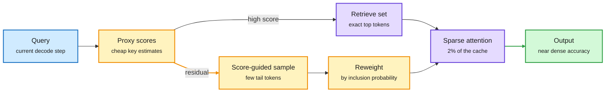

# Stratified Sparse Attention: retrieve the heavy hitters, sample the rest, correct the bias

**Source:** HuggingFace daily papers 2026-10-22: [Stratified Sparse Attention: Reducing the Sparse-to-Dense Gap at Extreme Sparsity, 2610.28441](https://arxiv.org/abs/2610.28441). Code: [github.com/skylight-org/SSA-Paper-Code](https://github.com/skylight-org/SSA-Paper-Code). Raw: `raw/huggingface/2026-10-22-stratified-sparse-attention-reducing-the-sparse-to-dense-gap.md`. No alphaxiv overview yet; written from the abstract.

## TL;DR

Long-context decode is bound by reading the KV cache (the stored keys and values of every past token). Sparse attention reads only a slice of it. There are two families. Top-k retrieval reads the highest-scoring tokens and throws away the long tail of small attention weights. Sampling reads a random subset, which covers the tail but adds variance. Hybrids glue the two together with uniform sampling and still lose a lot at extreme sparsity. **SSA** borrows stratified sampling from survey statistics. It attends deterministically to the top-scoring tokens, then samples the remaining tokens in proportion to a cheap proxy score, and reweights each sampled token by its inclusion probability so the estimate of the residual attention mass stays unbiased. Top-k, top-p and top-k-plus-uniform are all special cases. At **50x attention sparsity** on RULER-HARD with Ministral-3-8B, accuracy rises from 81.8% to 84.2% at 32K and from 63.8% to 69.3% at 128K over the strongest practical baseline, recovering 94% and 85% of dense attention. Custom CUDA kernels deliver **up to 2.96x decode speedup over FlashInfer at 1M context**. Tested on five models from 3B to 27B across RULER, LongBench, LOFT and AIME.

Read the top of the cache exactly, estimate the tail

The importance-weighted sample is what recovers the attention mass top-k throws away.

Blue is the query, amber is the scoring and sampling path, purple is exact attention, green is the result.

## Key findings

- Top-k alone is biased: it drops every small weight, and at 128K the tail adds up to a lot of mass.
- Score-guided sampling with inclusion-probability correction beats uniform sampling at matched budget, because it spends samples where the proxy says mass is.
- Gains grow with context length (2.4 points at 32K, 5.5 points at 128K on RULER-HARD), which is where sparse attention matters most.
- The kernel result (2.96x over FlashInfer at 1M) says the sampling overhead does not eat the bandwidth win.

## How this relates to prior wiki pages

- **Fills a gap DoSA (10-15) left open.** DoSA (the paper that bounds which keys can make the top-K so the indexer skips scoring them) made top-k cheaper but kept top-k's bias. SSA attacks the bias itself. The two compose: DoSA could build the retrieve set, SSA estimates the tail. See [kv-cache](kv-cache.md).
- **Confirms the "estimate, don't discard" thread** in the KV-eviction literature. DropKV (Kurate underrated, 10-22: near-optimal eviction via residual-output perturbation) and QuantWM (10-06: Key errors hurt more than Value errors because they change which tokens get selected) both say the selection step is where accuracy is lost. SSA is the first to treat the discarded mass as something to estimate statistically.
- **Contrast with MiniMax M3/M3.1's MSA** (block-sparse attention with a cheap block selector, now in llama.cpp and TensorRT-LLM; see [the operator-gap summary](2026-10-23-serving-operator-gap-semianalysis-minimax.md)). MSA is a trained architecture. SSA is training-free and works on dense-trained models.
- Related: [attention-mechanisms](../llms-foundation-models/attention-mechanisms.md), [model-pruning-sparsity](model-pruning-sparsity.md).

## Gaps

- Variance per decode step is not reported in the abstract. Unbiased on average can still mean an unlucky sample on a critical token.
- Interaction with paged KV layouts and prefix caching in vLLM/SGLang is untested.
- The 2.96x is at 1M context. Speedup at the 32K-128K range most deployments use is not stated.
- No multi-turn agent workloads, where the "tail" of old tool outputs is the cache bulk.

## Research angle

Sampling makes decode stochastic even at temperature zero. A deterministic variant (fixed low-discrepancy sample per head, refreshed per chunk) would keep reproducibility. A second direction: use the inclusion probabilities as an eviction signal, since tokens that are never sampled over many steps are safe to page out.
