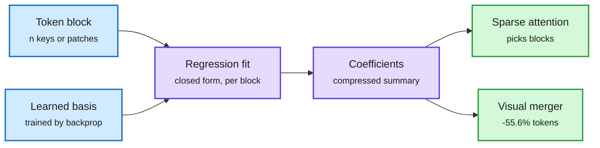

# Compression shorts (2026-10-24)

## TTR-Compressor: compress a sequence by fitting a regression to it (2610.31574)

Block-sparse attention and visual-token mergers both need to squeeze many tokens into few. The usual tools are pooling or a learned projection. This paper treats the tokens of a block as data for a small regression problem and uses the fitted coefficients as the compressed summary. The regression's form is learned by backprop, but its coefficients are solved in closed form in the forward pass, so the compressor adapts to each block at test time. As the block summarizer inside block-sparse attention it beats attention-based compressors on RULER "by a large margin." As a visual-token merger it matches the standard MLP merger with 55.6% fewer visual tokens.

The summary is a fitted model, not an average

Each block's tokens define a least-squares problem; its closed-form coefficients become the block key.

Blue are inputs, purple is the test-time fit, green are the two uses.

**Relation:** fits the "attention is a fast-weight MLP, so efficient attention either routes or compresses it" taxonomy from MiTA (2602.01219, resurfaced on X 10-23/24). TTR is a better compressor for the routing step. It also bears on the 10-23 Stratified Sparse Attention result (read the top of the KV cache exactly and sample the tail): both need a cheap, faithful block summary to decide what to read.

## T²Quant: diffusion LMs need different precision per task and per step (2610.31198)

Diffusion language models (DLMs, which denoise a whole block of tokens over many steps instead of writing one token at a time) are sensitive to quantization in a way that depends on both the task and the denoising step. T²Quant predicts that sensitivity without labels and allocates activation precision across steps under a fixed bit budget. Up to +6.7 points average accuracy over existing quantizers at the same budget, across three DLMs and six benchmarks.

## Diffusion LMs change speed across tasks and languages (2610.25835)

Forward passes per token vary a lot. In DiffusionGemma, story writing needs over 3x the passes per token of grammar correction. Two properties explain it: how much of the output is new relative to the input, and how rare its words are. Heavily tokenized languages pay extra. Wrong answers take more passes per token than right ones, so weighting candidates by decoding speed beats majority voting by up to 4.2 points at no extra cost. **Implication:** DLM serving cost is workload-dependent, so "N tokens per pass" headline numbers need a task mix attached.

## What makes a good unmasking policy? (2610.31576)

A controlled study of learned unmasking (which predictions a masked DLM commits each step). A policy must cut about 10% of function evaluations to pay for itself at up to 7.5M parameters. An 856K-parameter policy trained on "trajectory-contraction" targets (accept only commitments that stay on a reference trajectory) gets the best accuracy-vs-NFE frontier on GSM8K for LLaDA-8B and transfers to Dream-7B.

## Practitioner: Qwen3.8-27B from 82 to 381 tok/s on one RTX 3090

Two X posts (secondhand, developer "TeksEdge") report a decode stack on 24 GB: baseline 82 tok/s; tuned MTP (multi-token prediction drafts) 114; DFlash2 drafter plus context lookup 138; optimized lookup verification 381. Context lookup proposes spans already present in the prompt (blocks up to 16 tokens, ~15 accepted), so the gain is largest when output copies input, which matches the diffusion-cost finding above. A second config (NVFP4 W4A4 weights and activations, FP8 KV cache, MTP, 8 concurrent requests) reports 367.9 tok/s aggregate in ~20 GB. Unverified and workload-specific.

## TensorRT 11.1 Global Performance Tuner (NVIDIA)

TensorRT now exposes more than 200 compiler knobs (fusion choice, tactics, codegen paths) as explicit "build routes." `trtexec` expands a route expression, builds and times each candidate, discards those that crash or fail an accuracy check, and keeps the fastest. Accuracy is a filter, speed is the ranking. Across ten workloads tuning gave 1.14x to 1.63x end-to-end over the default route. Resumable with a tuning cache. This is autotuning moved from kernels to the whole compiler pipeline.

## EdgeRock-4B: fixed-size memory for long reasoning

An open 4B text-and-image model keeps recent tokens plus a learned compressed summary, so memory stays flat as reasoning grows. Trade-offs named by the poster: the model chooses what to forget, accuracy varies by task, and serving needs engine support for the custom memory ([@svpino](https://x.com/svpino/status/2113690674742849836)). Same bet as the KDA layers in Kimi K3.

## Relation to prior wiki

- **Diffusion-LM efficiency is now a steady stream:** looped uniform DLMs (10-23, 2.8-3.3x fewer training FLOPs), DiffResearch (10-23, ~6x faster deep research), and today's three papers. Today's contribution is cost accounting: DLM speed depends on output novelty, and precision needs depend on the step.
- **Speculative decoding** concept page: context lookup is the copy-heavy special case of drafting; see [speculative-decoding](speculative-decoding.md).
