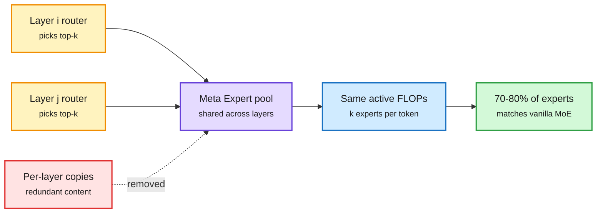

# Meta Expert: Cross-Layer Expert Sharing for Storage- and Retrieval-Efficient MoE

**Links:** [arXiv](https://arxiv.org/abs/2610.27598) · [HF](https://huggingface.co/papers/2610.27598) · cross-source confirmed (HF + Kurate)

## TL;DR

In a standard mixture-of-experts (MoE) model, each layer owns its own experts (the small feed-forward sub-networks a router picks per token). The paper measures that experts in different layers store very similar content, so a lot of parameters are duplicates. It replaces per-layer "Local Experts" with "Meta Experts" shared across layers. With activated experts and expert size held fixed, the shared design matches a vanilla MoE using only 70-80% of the experts, with lower parameter redundancy, lower cross-entropy loss and higher downstream accuracy. A theory section argues that a shared expert gives hidden states more flexible residual pathways, which the authors call better "information retrieval efficiency." Abstract-level only: no alphaxiv overview yet, and scale details are not in the abstract.

One expert pool serves many layers

Layers keep their own routers but draw from a shared bank, so duplicate experts disappear.

Amber are per-layer routers, purple is the shared pool, red is the redundancy removed, green is the parameter saving.

## Relation to prior wiki

- **Second paper making this exact move.** UniPool ([05-09](2026-05-09-unipool-shared-expert-pool-moe.md)) replaced per-layer experts with one global pool accessed by per-layer routers and beat vanilla MoE at matched active parameters (182M to 978M scale). Meta Expert reaches the same conclusion from a redundancy measurement, and reports the saving as an expert-count reduction (20-30%). Two independent groups, five months apart, same architecture. One more and it is a pattern.
- **Complements expert pruning** ([SlimWise, 10-08](2026-10-08-slimwise-phase-decoupled-expert-pruning.md); [ACE expert skipping, 09-08](2026-09-08-ace-expert-skipping-moe.md)): those remove experts after training. Meta Expert never trains the duplicates.
- **Serving angle:** fewer unique experts means a smaller checkpoint, which matters for the NVMe expert-streaming regime ([kimi-k3-in-c, 09-12](2026-09-12-kimi-k3-in-c-nvme-expert-streaming.md)), where total bytes, not active FLOPs, set latency.

## Gaps

Scale and token budget are not stated in the abstract. Load balancing across a shared pool (UniPool needed a pool-level auxiliary loss and NormRouter) and expert-parallel placement (a shared expert must live on a device all layers can reach) are the obvious systems questions.

## Research angle

Shared experts break the assumption behind layer-wise expert-parallel sharding. Whether a shared pool helps or hurts all-to-all traffic (the dominant MoE communication cost; 60-70% of MoE comm volume per today's SemiAnalysis Trainium piece) is unmeasured.
