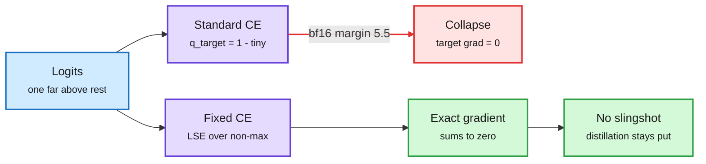

# A Fix for Softmax and Cross-Entropy (Barron, Gnanapragasam, Tschannen; Google DeepMind)

**Links:** [arXiv](https://arxiv.org/abs/2610.31642) · [project page + demo](https://jonbarron.info/softmaxfix/) · [alphaXiv](https://www.alphaxiv.org/abs/2610.31642)

## TL;DR

Every framework computes softmax and cross-entropy by subtracting the largest logit first to avoid overflow. The paper shows that this standard recipe still has two rounding bugs. **Softmax Collapse:** when the correct class's logit far exceeds the rest, the denominator becomes 1 plus a sum too small to register, so the target gradient (computed as "probability near 1, minus 1") rounds to exactly zero while the non-target gradients stay positive. Gradients stop summing to zero. The cliff sits at a logit margin of about 5.5 in bf16, 16.6 in fp32 and 36.7 in fp64. **Softmax Cancellation:** in soft-target distillation, when student logits approach teacher logits, the true gradient goes to zero but the standard computation plateaus at a non-zero noise floor, so the student keeps being pushed away from its teacher. The fix computes the tiny quantities directly (log-sum-exp over the non-maximum classes) instead of subtracting nearly equal rounded numbers.

The bug is a subtraction, the fix is to never do it

Confident logits push the target gradient below precision; the fixed kernel computes the residual directly.

Blue is the input, purple are the two implementations, red is the failure, green is the corrected result.

## Key results (toy scale)

- Eliminates the "Slingshot" loss-spike phenomenon on grokking benchmarks; one setting goes from 94.3% to 100% test accuracy.
- Without weight decay (squared modular addition mod 97), standard loss sees test accuracy fall from 61% to 23% around step 1,250; the fixed loss continues to 85% (alphaXiv overview of Fig. 2).
- Stops student drift in soft-target distillation without raising numerical precision.
- After memorization, logit growth is bounded by an equilibrium between weight decay and Adam's epsilon.

## Relation to prior wiki

- **Direct link to the distillation thread.** The wiki has logged many on-policy and soft-target distillation recipes ([knowledge-distillation concept](knowledge-distillation.md)). None audited the loss kernel. If cancellation noise is real at LLM scale, part of the "student plateaus below teacher" gap reported across those papers could be numerics, not learning.
- **Low-precision training angle.** The bf16 cliff at margin 5.5 is low. Confident LM heads routinely exceed it, which makes this relevant to FP8/BF16 training-stability work tracked under [quantization](quantization.md).

## Gaps

All experiments are small (grokking, toy distillation). No LLM pre-training or large-vocabulary run. Fused cross-entropy kernels (Liger, chunked CE) may already avoid some of this, and the paper does not test them.

## Research angle

Test the fix inside a fused large-vocabulary CE kernel during on-policy distillation of a 7B student. If student-teacher KL plateaus lower, a share of reported distillation gaps is a rounding artifact.
