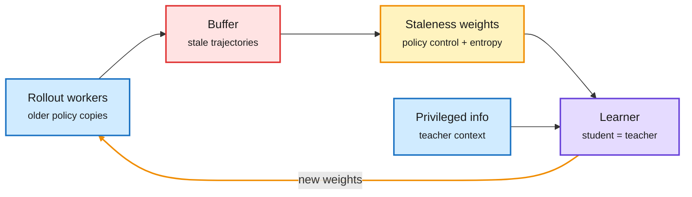

# AsyncOPSD: take rollouts off the critical path of self-distillation

**Source:** arXiv [2610.25880](https://arxiv.org/abs/2610.25880) (Wu, Qi, Ji, Gao), Kurate cs.LG weekly #14 · raw: `raw/kurate/2026-10-25-cs-lg.md`
**Topic:** on-policy self-distillation, training systems

## TL;DR

On-policy self-distillation (OPSD) uses one model as both student and teacher; the teacher copy sees privileged information (for example the reference solution). It is simple, but synchronous rollout generation dominates training time. AsyncOPSD decouples rollout workers from the learner. Because teacher and student share weights, there is no multi-model sync to coordinate. Stale rollouts from older policies are handled with a staleness-aware policy-control term and token-level entropy weighting. Result: 1.96-2.25x throughput over synchronous OPSD across three model sizes on math benchmarks, with slightly higher average accuracy.

One model, two roles, no waiting

Rollouts stream into a buffer; the learner corrects for how old each one is.

Blue is input, red is the staleness risk, amber is the correction, purple is the shared model; the amber arrow is the async loop.

## Relation to prior wiki pages

- **Systems counterpart** to the October self-teacher wave on the [knowledge distillation](knowledge-distillation.md) page: BSD and RSD (10-23) made the student its own scorer; AsyncOPSD makes that recipe cheap to scale. Shared weights are what make asynchrony easy, an advantage separate-teacher OPD lacks.
- **Same pattern as async RL** (off-policy correction for stale rollouts) now applied to distillation.
- **Gap:** math only; no comparison against async OPD with a separate teacher at equal compute; staleness bounds not reported.
