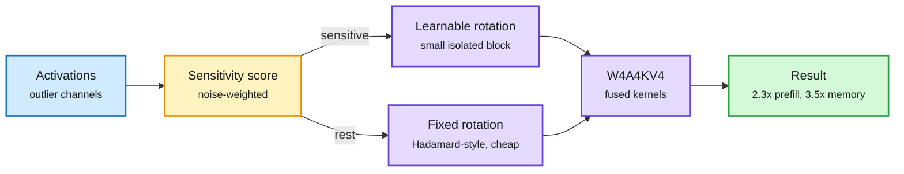

# LIRQuant: learn rotations only for the channels that need them

**Source:** arXiv [2610.25675](https://arxiv.org/abs/2610.25675) (Xu et al.), Kurate cs.AI weekly #13 · raw: `raw/kurate/2026-10-25-cs-ai.md`
**Topic:** post-training quantization, W4A4KV4, rotation methods

## TL;DR

Rotation-based PTQ (QuaRot, SpinQuant, OSTQuant) smooths activation outliers by rotating every channel with one global transform, fixed or learned. LIRQuant scores each channel's sensitivity to quantization noise, applies an expressive learnable rotation only to the sensitive block, and a cheap fixed rotation to the rest. It reports state-of-the-art W4A4KV4 accuracy on LLaMA-2/3, Mistral, Qwen3 and Mixtral, calibrates LLaMA-3-8B in 25 minutes at 20.3 GB peak memory (fastest and smallest among learnable-rotation methods), and its fused kernels give up to 2.3x prefill speedup and 3.5x memory saving over FP16.

Spend the expensive rotation only where noise hurts

A sensitivity score splits channels; each group gets a different rotation.

Blue is the input, amber is the split decision, purple is the transform and quantized compute, green is the result.

## Key findings

- Decoupling the rotation shrinks the optimization problem: fewer learnable parameters, so calibration is fast and fits in ~20 GB.
- Outlier smoothing is preserved because outliers live mostly in the sensitive channels.
- Covers KV at 4 bits too (W4A4KV4), the hardest common setting.

## Relation to prior wiki pages

- **Same move as** the 10-23 [PACE](2026-10-23-pace-four-bit-recurrent-states.md) and MiniMax M3.1 Flash disclosures: keep a small sensitive slice at higher fidelity, treat the rest cheaply. This is the third "protect the fragile slice" compression result in a month on the [quantization](quantization.md) page (with the 10-16 kv-cache entry "protect the fragile slice").
- **Caveat** from the 10-23 MiniMax talk: KV4 kept averages flat while one sub-score fell 6.6 points. LIRQuant reports averages; per-slice evals are not shown.
- **Gap:** no long-context (>32K) or agentic evals, where 4-bit KV errors compound.

## Research angle

Can the sensitivity metric be shared with the KV budget allocator (MOSAIC, same day) so one profile decides both bits per channel and slots per layer?
